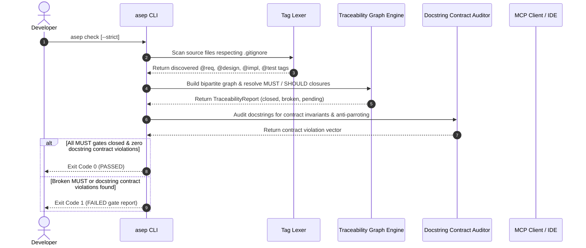

# Repository Architecture & Physical Topology Map

<!-- @gov:ARCH-OVERVIEW -->
## 1. System Overview

`ASEP` (Axiomatic Systems Engineering Protocol) implements a decoupled, living specification engine and deterministic SDLC validation framework. High-level software engineering requirements, architecture patterns, and interface contracts are organized into modular, autonomous protocols that govern both human development and AI coding agents.

The core engine is written in Rust (2021 edition) and operates as a standalone binary CLI (`asep`) and Model Context Protocol (MCP) server. It validates 1:1 closed-loop traceability graphs, audits function docstring contracts according to Meyer's Design by Contract, and packages canonical skills for 11 modern agentic AI environments.

---

<!-- @gov:ARCH-TOPOLOGY -->
## 2. Physical Directory Topology

```text
/
├── README.md                # Repository entrypoint (10-point SWEBOK v4 specification)
├── MANUAL.md                # Comprehensive Diátaxis developer and operator manual (Parts I–V)
├── ARCHITECTURE.md          # Architectural topology map and boundary invariants
├── CONTRIBUTING.md          # Contributor gates, CI expectations, and commit standards
├── SECURITY.md              # Coordinated vulnerability disclosure policy and CVSS SLAs
├── CHANGELOG.md             # Semantic release history and version tracking
├── LICENSE                  # Open-source MIT license
├── trace_manifest.json      # Dynamic Option C verified trace manifest
├── .asepignore              # Traceability and scanner ignore rules
├── system-architecture/     # Core Systems Architecture Protocol
│   ├── system-architecture.md # Specification document (2-Phase SDLC & Traceability)
│   ├── adr/                 # Architecture Decision Records
│   ├── diagrams/            # PlantUML models and compiled SVG assets
│   └── skill/SKILL.md       # AI agent guidance for systems architecture
├── workflow-router/         # Master Agent Dispatch & Skill Orchestrator
│   ├── workflow-router.md   # Skill routing protocol specification
│   └── skill/SKILL.md       # AI agent guidance for workflow dispatch
├── engineering-specs/       # Technical Specification Protocol
│   ├── engineering-specs.md # ISO/IEC/IEEE 29148:2018 requirements grammar
│   ├── skeletons/           # Adaptive skeletons (PRD, TDD, ADR, Runbook, Alloy .als, TLA+ .tla)
│   ├── templates/           # 4 canonical PlantUML diagram templates (.puml)
│   └── skill/SKILL.md       # AI agent guidance for engineering specifications
├── code-contracts/          # Code-Level Contracts Protocol
│   ├── code-contracts.md    # SWEBOK 4.4 Design by Contract standard
│   ├── templates/           # Idiomatic contract templates (Rust, TS, Python, Go, C++)
│   └── skill/SKILL.md       # AI agent guidance for docstring contracts
├── repository-governance/   # Governance and Navigation Protocol
│   ├── repository-governance.md # Repository structure, SCM layout, CVD policy, Diátaxis MANUAL
│   ├── templates/           # Templates for governance artifacts (README, ARCH, MANUAL, SECURITY)
│   └── skill/SKILL.md       # AI agent guidance for repository governance
├── design-tokens/           # Visual Design Tokens Protocol
│   ├── design-tokens.md     # KDL AST design token specification
│   ├── templates/           # KDL token schema templates
│   └── skill/SKILL.md       # AI agent guidance for design tokens
└── spec-engine/             # Rust Validation Engine & Multi-Agent Packager
    ├── Cargo.toml           # Package manifest (asep v2.1.0, MSRV 1.80+)
    ├── src/                 # Engine source modules
    │   ├── main.rs          # CLI entrypoint for asep binary
    │   ├── runner.rs        # CLI argument dispatcher and ANSI/JSON reporting
    │   ├── cli.rs           # Clap derive command definitions
    │   ├── scanner/         # AST tag scanner respecting .gitignore and .asepignore
    │   ├── graph/           # 1:1 bipartite traceability graph closure builder
    │   ├── auditor/         # Docstring contract and anti-parroting auditor
    │   ├── pack/            # Universal 11-agent packager & auto-detection engine
    │   ├── skill/           # Skill lifecycle manager & adaptive editor dispatcher
    │   ├── mcp/             # Model Context Protocol stdio server
    │   ├── init/            # Living spec project scaffolder
    │   └── bin/             # Backward-compatible spec-engine binary alias
    ├── benches/             # Criterion micro-benchmarks for AST lexer, graph, and docstring contracts
    └── tests/               # 46 integration, unit, and protocol test suites
```

---

<!-- @gov:ARCH-INVARIANTS -->
## 3. Architectural Boundary Invariants

The following architectural constraints are strictly enforced:

1. **Protocol Decoupling:** Engineering protocols (`system-architecture`, `engineering-specs`, `code-contracts`, `repository-governance`, `design-tokens`) are autonomous and self-contained. No protocol may hardcode external third-party skill dependencies.
2. **Zero Inward CLI Coupling:** Protocol documentation must remain valid independently of whether `asep` is executed via Rust cargo, native binary release, or Dart runner distribution.
3. **Traceability Closure:** Production logic cannot be merged with broken `@req:*:MUST` gates. Every required domain interface must have an `@impl` and `@test` counterpart.
4. **Dual-Mode SDLC Invariant:** Features in Velocity Mode (RAD) operate on `@req:*:DRAFT` tags on development branches. Merging `dev` into `main` requires complete in-place hardening with zero `@req:*:DRAFT` tags (enforced by `asep check --deny-drafts`).
5. **Clean Exit Codes:** CLI tools return Exit Code 0 on clean pass, Exit Code 1 on validation failure, and Exit Code 2 on configuration or I/O failure.

### Concurrency & Parallelism Guidelines (ARCH-11)

**Physical vs logical core allocation:** Compute, AST parsing, regex scanning, and SIMD pipelines must target physical CPU cores (`num_cpus::get_physical()`). Logical threads (SMT/hyper-threads) are reserved strictly for I/O concurrency and latency hiding.

**Partitioned accumulation buffers:** Prefer per-thread accumulation buffers and final-phase reduction over shared mutable atomics to eliminate MESI cache-coherence bus invalidations.

**Amdahl scaling limits:** Parallel speedup is governed by Amdahl's Law with serial fraction $s \le 0.05$. Gustafson's weak scaling applies to batch processing workloads.

---

<!-- @gov:ARCH-LIFELINE -->
## 4. Verification Lifeline



---

<!-- @gov:ARCH-BINDING -->
## 5. Living Specification Alignment

- **Requirements Grammar:** Defined in `engineering-specs/engineering-specs.md`
- **Architecture Lifecycle:** Governed by `system-architecture/system-architecture.md`
- **Master Dispatch & Routing:** Governed by `workflow-router/workflow-router.md`
- **Low-Level Code Contracts:** Governed by `code-contracts/code-contracts.md`
- **Repository Governance:** Governed by `repository-governance/repository-governance.md`
- **Visual Design Tokens:** Governed by `design-tokens/design-tokens.md`
- **Formal Invariant Proofs:** Alloy (`.als`) and TLA+ (`.tla`) specifications under `engineering-specs/skeletons/` and `docs/invariants/`
- **Dynamic Trace Manifest (Option C):** Verified via `trace_manifest.json`
