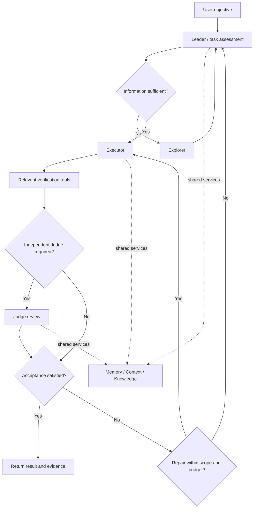
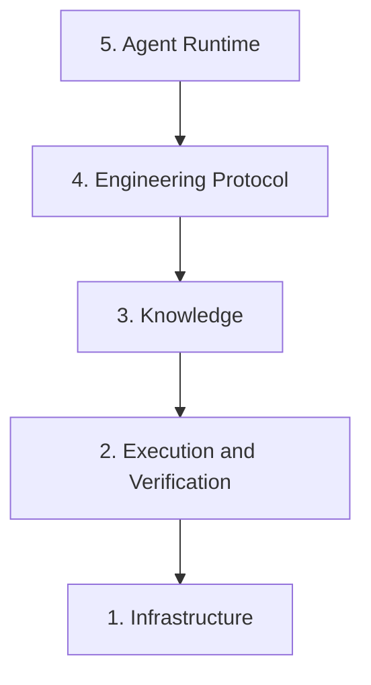

# ASEP — Adaptive Agentic Engineering Architecture

> Draft RFC v0.2 · 24 November 2026  
> Status: Proposed — requires repository audit and empirical validation  
> Repository: https://github.com/civitas-project/asep

## 1. Executive summary

ASEP (Axiomatic Systems Engineering Protocol) diusulkan bergeser dari **prescriptive engineering protocol** menjadi **adaptive agentic engineering infrastructure**.

Tujuannya bukan mengajari ulang LLM software engineering, tetapi melengkapi keterbatasannya melalui persistent memory, context management, perception, execution control, dan independent verification. Kedalaman proses engineering disesuaikan dengan kompleksitas, ketidakpastian, dan risiko task.

Lima konsep inti:

| Concept | Pertanyaan yang dijawab |
|---|---|
| Role | Apa tanggung jawab agent? |
| Engineer level | Seberapa luas cakupan kompetensi agent? |
| Engineering rigor | Seberapa mendalam proses yang diperlukan task? |
| Capability | Kapabilitas tambahan apa yang diperlukan? |
| Verification | Bukti apa yang diperlukan untuk menerima hasil? |

**Default:** satu agent, proses lightweight, dan verification yang relevan. Tambahkan mekanisme hanya ketika memberikan manfaat yang dapat dibuktikan.

## 2. Architectural principles

| ID | Principle | Ketentuan usulan |
|---|---|---|
| AX-01 | Non-redundancy | Gunakan kemampuan native LLM dan runtime yang sudah memadai; jangan menduplikasi tanpa justifikasi. |
| AX-02 | Proportionality | Kedalaman proses, artefak, dan verifikasi harus sebanding dengan kebutuhan task. |
| AX-03 | Augmentation | Prioritaskan kapabilitas eksternal yang tidak dapat dijamin LLM sendiri. |
| AX-04 | Independent verification | Klaim keberhasilan harus didukung bukti yang sesuai dengan acceptance criteria. |
| AX-05 | Empirical justification | Ukur manfaat, biaya, dan overhead sebelum menjadikan mekanisme sebagai default. |
| AX-06 | Authority separation | Role, kompetensi, dan izin eksekusi tidak boleh disamakan. |
| AX-07 | Model portability | State, kontrak, dan bukti tidak terikat pada satu model atau provider. |

## 3. Agent model

### 3.1 Role — tanggung jawab

| Role | Responsibility | Expected output |
|---|---|---|
| Leader | Menentukan arah, scope, prioritas, keputusan, dan delegasi. | Task objective, acceptance criteria, keputusan atau eskalasi. |
| Executor | Mengimplementasikan task dalam scope yang diberikan. | Perubahan aktual, hasil pengujian, blocker. |
| Judge | Mengevaluasi hasil terhadap acceptance criteria dan evidence. | Verdict, temuan, bukti, serta kebutuhan perbaikan. |
| Explorer | Mengeksplorasi repository, masalah, dependency, dan alternatif. | Temuan terstruktur, referensi, ketidakpastian. |

Role adalah tanggung jawab logis, bukan kewajiban membuat empat proses atau empat model. Satu agent dapat menjalankan beberapa role secara bergantian. Apabila independensi review diwajibkan, Executor tidak boleh menjadi satu-satunya Judge atas hasilnya sendiri.

### 3.2 Engineer level — cakupan kompetensi

| Level | Scope | Contoh pekerjaan |
|---|---|---|
| L1 | Function, component, implementation | Memperbaiki fungsi, membuat test, mengubah komponen. |
| L2 | Module, subsystem, integration | Mendesain API modul, refactoring lintas file, integrasi subsystem. |
| L3 | Architecture, system, strategic decision | Menilai trade-off arsitektur, invariant lintas sistem, batas subsystem. |

Role dan level bersifat orthogonal. Contoh: `Executor:L3`, `Judge:L1`, `Explorer:L2`, `Leader:L3`. Tidak perlu membuat 12 profil agent permanen.

Level bukan ukuran model, senioritas manusia, atau izin akses. Level merupakan klasifikasi cakupan pekerjaan yang dapat diberikan berdasarkan capability evidence. Model yang kuat tetap dapat mengerjakan task L1.

### 3.3 Engineering rigor — kedalaman proses

| Mechanism | Lightweight (default) | Structured | High Assurance |
|---|---|---|---|
| SDLC | Minimal | Tahap relevan | Komprehensif jika diperlukan |
| Specification | Objective dan acceptance criteria | Structured specification | Invariant dan specification mendalam |
| Contracts | Bila diperlukan | Interface contracts | Kontrak eksplisit sesuai risiko |
| Formal methods | Tidak secara default | Kondisional | Jika ada properti yang memerlukan pembuktian/model checking |
| Delegation | Tidak wajib | Selektif | Berdasarkan kebutuhan koordinasi |
| Verification | Relevant checks | Integration dan regression checks | Risk-specific assurance dan independent review |
| Documentation | Minimal | Artefak teknis relevan | Bukti dan dokumentasi sesuai kebutuhan assurance |

Rigor independen dari engineer level. Misalnya, perubahan satu baris pada sistem kritis dapat memerlukan High Assurance walaupun implementasinya L1. Sebaliknya, eksplorasi arsitektur L3 yang belum mengubah sistem dapat menggunakan Lightweight.

Rigor meningkat jika dampak, ketidakpastian, risiko, atau sulitnya pemulihan meningkat. Batas kewenangan dan kebijakan keamanan tidak dinonaktifkan pada Lightweight.

## 4. Adaptive workflow

Alur di atas bersifat konseptual, bukan fixed state machine yang harus dijalankan secara lengkap pada setiap task. Pada task sederhana, Leader dan Executor dapat berupa agent yang sama, Explorer dilewati, dan verification cukup memakai pemeriksaan yang relevan. Eskalasi ke manusia diperlukan ketika izin, perubahan scope, atau keputusan penting tidak dapat diselesaikan secara sah oleh agent.

Contoh:

| Task | Role/level | Rigor | Evidence |
|---|---|---|---|
| Perbaiki padding tombol | Executor:L1 | Lightweight | Screenshot atau UI test relevan |
| Refactoring API modul | Leader/Executor:L2; Judge jika diperlukan | Structured | Unit dan integration tests; compatibility check |
| Rancang transaction engine | Leader:L3, Explorer/Executor/Judge sesuai scope | High Assurance jika risiko menuntut | Invariant, property tests, model checking jika relevan |

## 5. Five-layer architecture

Diagram menunjukkan pengelompokan tanggung jawab, bukan aturan bahwa semua request wajib melewati seluruh layer secara linear.

| Layer | Responsibility | Capabilities |
|---|---|---|
| 5. Agent Runtime | Siapa yang bekerja dan bagaimana task dikoordinasikan? | Role, engineer level, capability routing, delegation, ReAct, resource budgeting. |
| 4. Engineering Protocol | Aturan apa yang relevan untuk task? | Adaptive rigor, graph-based design, decision-making, governance, SDLC selektif. |
| 3. Knowledge | Informasi apa yang diketahui dan dibutuhkan agent? | CoALA-inspired memory, Context Compiler, Knowledge Graph, Failure Learning. |
| 2. Execution & Verification | Bagaimana perubahan dilakukan dan hasil dibuktikan? | Execution/recovery, testing, impact analysis, Computer Vision, simulation, design conformance. |
| 1. Infrastructure | Apa yang menunjang seluruh capability? | Storage, sandbox, telemetry, runtime adapters. |

### 5.1 Conceptual foundations, not standalone engines

- **CoALA:** fondasi pengelolaan working, episodic, semantic, dan procedural memory. Checkpoint sebelum compaction atau penutupan sesi digunakan jika runtime mendukung hook; periodic/event-driven persistence menjadi fallback.
- **ReAct:** fondasi reasoning–action–observation loop. Gunakan loop native runtime jika memadai; ASEP dapat menambahkan action contracts, observasi, budget, dan evidence tanpa memaksa penyimpanan penalaran internal model.
- **Graph-based Design Thinking:** teknik desain opsional untuk task yang membutuhkan dekomposisi, data flow, failure channels, dependency, dan visual state. Tidak wajib untuk perubahan sederhana.

Referensi:
- Design Thinking: https://gist.github.com/r17x/90eb2f7be93932b5693753aedb09c01a#file-design_thinking-md
- CoALA: https://arxiv.org/abs/2309.02427
- ReAct: https://arxiv.org/abs/2210.03629

## 6. Consolidation of expansion proposals

Katalog 15 proposal sebelumnya dipertahankan sebagai inventory capability, bukan 15 engine atau protokol yang harus diimplementasikan secara terpisah.

| Proposal | Owning layer | Integration / simplification |
|---|---|---|
| Agent Capability | Runtime | Capability evidence dan routing berdasarkan task/level. |
| Agent Economics | Runtime | Resource budget dan escalation policy; gunakan metrik telemetry bersama. |
| Hierarchical Agent Orchestration | Runtime | Empat role logis, level sebagai atribut task; delegasi opsional. |
| Reasoning–Action Protocol | Runtime | Integrasi loop native melalui action/observation interface. |
| Engineering Decision | Protocol | Decision records dan graph-based design hanya saat material. |
| Agent Governance | Protocol | Authority, scope, approval, dan access policy. |
| Knowledge Graph | Knowledge | Shared relation model; perluas traceability yang ada. |
| Context Engineering | Knowledge | Context Compiler berbasis task, dependency, dan token budget. |
| Agent Memory | Knowledge | CoALA-inspired records, checkpoint, retrieval, reconciliation. |
| Failure Learning | Knowledge | Konsolidasi kegagalan menjadi evidence, test, atau aturan yang disetujui. |
| Impact Analysis | Execution & Verification | Gunakan graph/index bersama; estimasi dampak perubahan. |
| Execution & Recovery | Execution & Verification | Isolasi perubahan, journal, repair, dan recovery. |
| Visual Engineering | Execution & Verification | Screenshot/video analysis, Computer Vision, visual regression. |
| Engineering Simulation | Execution & Verification | Simulasi dan model checking berbasis risiko. |
| Agent Observability | Infrastructure | Shared telemetry untuk tool calls, biaya, hasil, dan overhead. |

## 7. Anti-overengineering policy

### 7.1 Keep, adapt, remove

| Treatment | Candidates |
|---|---|
| Keep as core capabilities | Context Compiler, Persistent Memory, shared Knowledge Graph/index, independent verification, Execution & Recovery. |
| Domain-specific capability | Computer Vision untuk UI, animasi, dokumen, dan aplikasi visual. |
| Activate selectively | SDLC, multi-language contracts, formal methods, graph-based design, independent multi-agent review, architectural decision records. |
| Simplify or remove after audit | Redundant prompts, duplicate stores/graphs, irrelevant quality gates, dokumentasi tanpa konsumen, wrapper yang tidak menambah manfaat. |

Keputusan penghapusan harus berdasarkan audit implementasi dan pengukuran, bukan asumsi bahwa LLM selalu melakukan pekerjaan dengan benar. Formal methods, kontrak, dan SDLC tidak dihapus secara kategoris; penggunaannya harus memiliki alasan konkret.

### 7.2 Admission criteria for a new capability

Sebelum menambah capability, evaluasi:

1. Apa masalah nyata yang belum diselesaikan secara memadai oleh LLM atau runtime?
2. Apakah fitur yang tersedia dapat digunakan kembali tanpa subsistem baru?
3. Apakah ada konsumen output yang jelas?
4. Apakah peningkatan kualitas, efisiensi, atau recoverability dapat diukur?
5. Apakah biaya implementasi, koordinasi, dan maintenance proporsional?
6. Dapatkah capability menjadi opsional apabila manfaatnya domain-specific?

Jika justifikasi tidak memadai, defer, merge, atau reject proposal.

### 7.3 Empirical evaluation

Bandingkan task yang sama dengan model, tool access, acceptance criteria, dan batas sumber daya yang sebanding:

| Configuration | Description |
|---|---|
| A | Native agent/runtime baseline dengan tools yang lazim tersedia. |
| B | Baseline + context dan persistent memory. |
| C | B + execution support dan independent verification. |
| D | C + structured/high-assurance process yang relevan. |

Metrics: task success rate, defect rate, token/tool usage, latency, rework, engineering overhead, dan cross-model consistency. Ulangi eksperimen untuk mengurangi pengaruh variasi output model; gunakan ablation per capability jika hendak mengisolasi manfaatnya. Tidak ada hasil benchmark aktual yang diklaim dalam RFC ini.

## 8. Proposed development priorities

| Priority | Focus | Exit criterion (proposed) |
|---|---|---|
| P0 | Audit redundansi ASEP saat ini | Inventory mekanisme existing, konsumen, overlap, dan baseline pengukuran. |
| P1 | Adaptive workflow dan agent roles | Role/level/rigor terpisah; task sederhana tidak dipaksa melalui workflow penuh. |
| P2 | Memory dan Context Compiler | Recovery lintas sesi dan context retrieval terbukti bermanfaat. |
| P3 | Knowledge Graph dan Impact Analysis | Memanfaatkan struktur/index yang sudah ada; relasi dan dampak dapat ditelusuri. |
| P4 | Computer Vision dan Visual Engineering | Pilot visual verification dengan evidence dan toleransi terukur. |
| P5 | Capability routing, economics, optimasi lanjutan | Peningkatan cost per verified result dibandingkan baseline. |

Governance, safety boundaries, telemetry minimal, dan verification yang relevan berlaku sejak awal. Prioritas di atas merupakan urutan investasi capability, bukan penundaan kontrol dasar. Urutan dapat berubah setelah audit.

## 9. Technical doubts for agentic review

| ID | Doubt | Required evaluation |
|---|---|---|
| AD-D01 | Redundansi dengan runtime native | Petakan capability yang sudah tersedia pada runtime dan ASEP; identifikasi gap aktual. |
| AD-D02 | Role overlap | Tentukan kapan satu agent cukup dan kapan independensi Judge memberikan manfaat. |
| AD-D03 | Level calibration | Rumuskan task scope dan capability evidence tanpa mengandalkan nama/ukuran model. |
| AD-D04 | Rigor misclassification | Tentukan indikator risiko, uncertainty, dan escalation; uji kasus task kecil berisiko tinggi. |
| AD-D05 | Orchestration overhead | Ukur biaya koordinasi dan kualitas terhadap single-agent baseline. |
| AD-D06 | Memory and context overlap | Tetapkan ownership state, retrieval, source of truth, dan mekanisme invalidasi. |
| AD-D07 | Lifecycle hook limitations | Audit dukungan compaction/session hooks; rancang fallback yang tidak menjanjikan checkpoint saat crash. |
| AD-D08 | Graph duplication | Evaluasi apakah traceability dan source index yang sudah ada dapat menjadi fondasi graph bersama. |
| AD-D09 | Verification independence | Bedakan objective checks, judgement subjektif, dan acceptance manusia; hindari self-certification. |
| AD-D10 | Formal methods applicability | Identifikasi properti yang benar-benar membutuhkan model checking, bukan sekadar test biasa. |
| AD-D11 | Visual backend cost | Ukur akurasi, toleransi, portability, dan overhead CV terhadap DOM/native screenshot tools. |
| AD-D12 | Migration compatibility | Audit dampak penyederhanaan terhadap skill, CLI, MCP, schema, dan existing quality gates. |

### Agentic review contract

Untuk setiap doubt, agent reviewer mencantumkan:

- Doubt ID dan evidence berupa path/symbol/commit repository yang relevan.
- Existing capability serta gap aktual.
- Alternatif (termasuk reuse atau tidak mengimplementasikan fitur).
- Trade-off, dependency, estimasi biaya, dan risiko.
- Validation plan serta acceptance criteria.
- Verdict: `ACCEPT`, `REVISE`, `MERGE`, `DEFER`, atau `REJECT`.

Jangan menganggap semua proposal disetujui. Jangan membuat implementasi hanya berdasarkan RFC ini sebelum scope dan keputusan terkait dikonfirmasi.

## 10. Conclusion

ASEP tidak harus menggantikan kecerdasan native LLM. ASEP harus memberikan capability tambahan, kontinuitas pengetahuan, batas kewenangan, dan verifikasi yang proporsional.

**Don't engineer what the LLM already knows. Engineer what the LLM cannot reliably guarantee.**

### Status and limitations

Dokumen ini merangkum dan mengonsolidasikan diskusi arsitektur sebelumnya. Ia merupakan RFC konseptual baru, bukan audit terbaru branch `main` atau `dev`, dan tidak mengubah katalog v0.1 maupun source code repository. Role, level, rigor, layer, prioritas, dan technical doubts masih merupakan usulan yang membutuhkan review dan validasi empiris.
