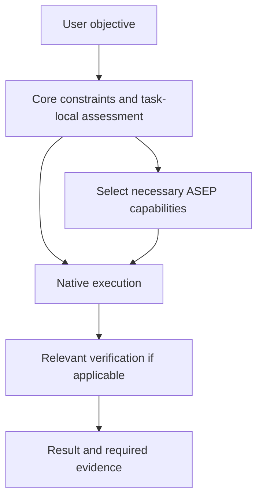

# ASEP Simplification & Consolidation

**Status:** Architectural decisions approved; implementation not yet performed  
**Basis:** Decisions 01–09, including 07.1–07.21, agreed during the architectural review  
**Reference snapshot:** `asep-dev(1).zip` (commit identity not established)  
**Language:** English, for consistency with ASEP engineering artifacts and agent consumption.

## 1. Objective

Reorient ASEP around a **Protocol-Driven Modular Engineering Framework** that improves engineering correctness and consistency across LLMs without imposing unnecessary tools, documents, orchestration, or execution steps.

The main observed problem is not the existence of engineering capabilities, but their unconditional activation and overlapping responsibilities. A simple user request must not trigger repository-wide scanning, `asep check`, `asep affected`, audits, PRD/TDD creation, or multi-agent delegation without a relevant reason.

Stop speculative capability expansion during consolidation. Preserve valuable functionality, remove demonstrated redundancy, and make optional mechanisms truly optional. Do not introduce a new runtime, graph engine, database, or crate merely to reorganize code.

## 2. Approved architectural decision register

| ID | Decision | Binding direction |
|---|---|---|
| 01 | Protocol-Driven Modular Engineering Framework (E) | Stable protocol; modular implementation; native runtime integration. |
| 02 | Adaptive Framework (C) | Govern correctness and constraints, not every execution step. |
| 03 | Hybrid Activation (C) | Default inactive; activate capabilities by relevant need, risk, contract, or explicit request. |
| 04 | Objective-Driven Engineering (C) | Objective and acceptance criteria first; SDLC is an optional methodology. |
| 05 | Adaptive Agent Orchestration (C) | Single agent by default; selective delegation and mandatory independent review where required. |
| 06 | Hierarchical Progressive Disclosure (C) | Concise core instructions, native discovery, on-demand skills and references. |
| 08 | Hybrid Repository Organization (C) | Organize root by artifact type and internals by domain. |
| 09 | Progressive Remediation (C) | Critical fixes first, related fixes during consolidation, full audit and optimization afterward. |

### 2.1 Component decisions (Decision 07)

| ID | Component | Verdict | Approved direction |
|---|---|---|---|
| 07.1 | `workflow-router` | MERGE (B) | Move fundamental activation rules into Core Protocol; distribute useful technical procedures to relevant skills; retire the standalone router. |
| 07.2 | `using-asep` | MERGE (B) | One canonical Core Protocol, distributed via native entry points; retire mandatory bootstrap skill. |
| 07.3 | `engineering-specs` | SIMPLIFY (B) | Requirements, specifications, acceptance criteria, traceability; conditional PRD/TDD and invariants. |
| 07.4 | `system-architecture` | SIMPLIFY (B) | Boundaries, dependencies, interfaces, invariants, architectural decisions and trade-offs; methodologies and specialized techniques become references. |
| 07.5 | `code-contracts` | SIMPLIFY (B) | Semantic information, pre/postconditions, side effects, error semantics and safety; no redundant documentation. |
| 07.6 | `repository-governance` | SIMPLIFY (B) | Information-driven documentation and repository organization; documents by need, not template completeness. |
| 07.7 | `design-tokens` | SIMPLIFY (B) | Adaptive Design System; semantic tokens, visual consistency, accessibility and interaction contracts; format and techniques conditional. Proposed name: `design-system`, subject to compatibility. |
| 07.8 | `srcwalk`, `srcidx`, `srcdump` | CONSOLIDATE (C) | Group under Source Intelligence while retaining independent crates and CLI compatibility; remove only demonstrated implementation duplication. |
| 07.9 | Traceability & Knowledge Graph | CONSOLIDATE (B) | One canonical typed relation model; impact, coverage, verification and context consume shared semantics. |
| 07.10 | Context Compiler | SIMPLIFY (B) | Composable inputs; explicit files, symbols, extraction or impact when relevant; no mandatory impact traversal. |
| 07.11 | Verification & QA | CONSOLIDATE (B) | Independent validators and relevant verification contracts; preserve trusted acceptance and evidence integrity. |
| 07.12 | `runtime` | DISTRIBUTE (B) | Move level, budget, action/observation contracts to their owning domains; retire misleading runtime category. |
| 07.13 | Agent Communication | SIMPLIFY (B) | Native-first; ASEP messaging only for unmet cross-runtime, asynchronous or durable exchange needs. |
| 07.14 | Observability | SIMPLIFY (B) | Evidence-first; separate required engineering evidence from optional operational telemetry; telemetry off by default. |
| 07.15 | MVCC Snapshot | REMOVE (C) | Remove unused MVCC infrastructure only after checking public API, downstream consumers and contracts; preserve Git snapshot identity for acceptance. |
| 07.16 | Skill Management & Packaging | SIMPLIFY (B) | Unified distribution; retain discovery, validation, installation, sync and adapters; evaluate redundant Git/package-manager features. |
| 07.17 | MCP Integration | SIMPLIFY (B) | Thin adapter; configurable capability exposure; shared core logic; compatibility and structured output when supported. |
| 07.18 | Configuration & Policy | CONSOLIDATE (B) | Separate core constraints, project policy, user preferences and native capability limits; one canonical rigor classification. |
| 07.19 | CLI & Command Execution | DISTRIBUTE (B) | Thin CLI adapter; shared core with MCP; no new CLI crate. |
| 07.20 | Project Initialization | SIMPLIFY (B) | Minimal, idempotent, non-destructive adoption; artifacts on demand; reuse skill distribution. |
| 07.21 | Supporting Utilities | SELECTIVE CONSOLIDATION (B) | `watch`: DEFER; `diagram`: SIMPLIFY; `clean`: SIMPLIFY; `self_update`: KEEP with integrity and replacement fixes. |

## 3. Target operating model



The diagram represents decision relationships, not a mandatory multi-stage runtime or a new routing service. A read-only question may require none of the engineering mechanisms. Selection must not require an ASEP subprocess or tool call of its own.

### 3.1 Activation contract

| Capability | Activate when | Do not activate merely because |
|---|---|---|
| `asep check` | The requested validation requires ASEP-specific contracts or an explicit check | An agent receives a request or makes any edit |
| `asep affected` | A change has uncertain relevant downstream impact and graph data can help, or the user requests it | A file changed |
| `asep context` | Multiple information sources need a bounded, composed engineering context | The agent needs to read a file |
| `srcidx` | Symbol-level or structural source intelligence adds value | Native search is available |
| `srcdump` | Structured extraction or controlled information density adds value | A source file exists |
| Audit | Explicit audit request or applicable risk/contract | Implementation is complete |
| PRD/TDD/ADR | Significant requirements, design, decisions or a project contract warrant them | Any coding task starts |
| Formal methods | A specific property warrants proof/model checking or a binding contract requires it | The software is generally described as complex |
| Independent Judge | High Assurance, specified high-risk changes, or explicit independent review requirement | A separate role is named in a workflow |
| Full CI | Required by project/acceptance contract or explicitly requested | A local relevant test passed |
| Agent messaging | Native delegation cannot meet actual exchange needs | Multiple agents exist |
| Telemetry | Explicit measurement or diagnostic need | A task executes |

Prefer native tools when sufficient. Avoid duplicate checks against unchanged inputs and equivalent evidence; invalidate evidence when its relevant inputs or contract change. A missing graph or unsupported capability is not proof of no impact. Required verification must never be silently waived; missing evidence is reported as incomplete/unverified.

### 3.2 Instruction architecture

- Maintain a single canonical Core Protocol, concise enough to load through native instructions.
- Discover skills via native metadata; load only relevant skill and references.
- Do not require task-to-skill mapping for every request. Native execution without any domain skill is valid.
- Retire `workflow-router` and `using-asep` as mandatory layers after migrating their necessary content and updating distribution references.
- Treat methodology, technical preferences and examples as conditional. Distinguish them from correctness, safety and binding project contracts.
- Audit **generated** instructions as well as canonical files: installer manifests, embedded assets, runtime presets, project init, existing managed installation upgrades.
- No fixed PRD/TDD/approval/delegation sequence for routine work. Honor actual approval requirements and explicit user instructions.

### 3.3 Ownership and orchestration

| ASEP owns | Native runtime/toolchain owns by default |
|---|---|
| Engineering constraints and evidence contracts | LLM inference and ReAct loop |
| Task scope and rigor semantics | Agent execution and delegation transport |
| Optional source/traceability intelligence | Ordinary file reads, search and edits |
| Optional deterministic engineering validators | Compiler, linter and test execution mechanisms |
| Project-specific engineering state/artifacts | Conversation, working context, native session state |
| ASEP distribution and integration adapters | Native permissions and actual runtime limits |

Keep AD-D02: roles are responsibilities, not permanent identities. Use one primary agent unless delegation has a material benefit or independent review is required. Native review/delegation first. Where independence is mandatory but unavailable, acceptance remains unverified. Agent judgement must not issue trusted `ACCEPTED` status; preserve the existing trusted-runner acceptance contract (AD-D09).

Keep AD-D06 native-first ownership; do not implement a new memory engine. ASEP may retain necessary engineering artifacts/checkpoints that native execution state cannot reliably preserve. Operational telemetry remains opt-in. A budget of `None` means no additional ASEP limit, not unlimited native resources; explicit limits must be honored when enforcement is supported and unsupported limits reported honestly.

## 4. Target repository organization

Illustrative target; exact names, moves, and file placement must follow the path-reference and compatibility audit. Do not create empty directories simply to match this diagram.

```text
asep/
├── AGENTS.md                  # Native entry point derived from canonical protocol
├── README.md                  # Orientation and reading path
├── Cargo.toml
├── Cargo.lock
├── protocol/                  # Canonical core instructions and constraints
├── crates/
│   ├── spec-engine/
│   │   ├── src/
│   │   │   ├── policy/
│   │   │   ├── traceability/
│   │   │   ├── verification/
│   │   │   ├── context/
│   │   │   ├── observability/
│   │   │   ├── communication/
│   │   │   ├── distribution/
│   │   │   ├── integration/
│   │   │   │   ├── cli/
│   │   │   │   └── mcp/
│   │   │   └── utilities/
│   │   └── tests/
│   └── source-intelligence/
│       ├── srcwalk/
│       ├── srcidx/
│       └── srcdump/
├── skills/
│   ├── engineering-specs/
│   ├── system-architecture/
│   ├── code-contracts/
│   ├── repository-governance/
│   └── design-system/
├── templates/
├── configs/
├── docs/
│   ├── guides/
│   ├── architecture/
│   ├── decisions/
│   ├── specifications/
│   └── reference/
├── experiments/
├── scripts/
└── vendor/                    # If still needed by supported offline builds
```

Existing root-level toolchain and ecosystem configuration files (including dot directories, CI configuration and licenses) may remain where required. Do not move files simply for visual symmetry. One canonical source per artifact; managed/generated copies must be identifiable and reproducible. Keep Rust workspace crate boundaries unless a separate decision authorizes changes. Provide a short architecture map and reading order: README → Core Protocol → architecture overview → relevant subsystem/skill. Clearly label normative documentation, actual implementation status, and experimental evidence.

## 5. Progressive remediation and execution plan

The sequence below is a proposed implementation breakdown of the approved decisions. It is not a mandate to introduce another workflow system. Use small reversible changes, preserve working compatibility, and avoid broad mechanical movement mixed with behavior changes.

| Phase | Scope | Exit evidence |
|---|---|---|
| S0 | Identify current snapshot, inventory components and consumers, verify suspected critical integrity/security issues | Snapshot identity or archive digest, dependency/path map, prioritized findings, known baseline limits |
| S1 | Remediate confirmed critical defects that would undermine migration, permissions, data or trusted acceptance | Targeted regression evidence; no silent fail-open for invalid permissions/evidence |
| S2 | Simplify Core Protocol, skills, runtime presets and generated instructions; unify rigor/activation semantics | Simple-task scenarios do not mandate extra ASEP calls; mandatory constraints still apply |
| S3 | Consolidate traceability, context, verification, source intelligence, communication, telemetry and distribution; retire MVCC if prerequisites satisfied | Shared semantics, preserved public contracts, relevant regression tests; no speculative infrastructure |
| S4 | Restructure repository and thin adapters; synchronize packaging, embedded assets, CI, docs and configs | No broken path references or packaging; old supported CLI/MCP entry points remain usable |
| S5 | Full correctness audit of the stabilized architecture | Prioritized verified findings, conditional risks, regression/acceptance evidence |
| S6 | Advanced optimization of retained components | Evidence-backed complexity/resource analysis; verified correctness; performance claims deferred if not measured |

Fix defects local to a component during its consolidation rather than optimizing code scheduled for removal. A blocker may reorder the work. Preserve minimal targeted testing throughout; do not run expensive global pipelines automatically.

### 5.1 Audit candidates inherited from the review

These are **revalidation targets**, not newly reproduced findings. Earlier line numbers refer to the supplied archive and may drift. Establish current file/line ranges, reachability, reproducible evidence, severity, root cause, trade-offs and regression criteria before remediation.

| Area | Candidate issue | Required verification |
|---|---|---|
| Configuration | Invalid config silently falls back to permissive defaults | Invalid/malformed policy cannot widen permissions; missing and invalid config handled distinctly |
| Trusted verification | Audit/tool errors may be interpreted as empty/successful evidence | Failed or unavailable mandatory checks remain failed/unproven; no false acceptance |
| Self-update | Missing visible artifact integrity verification and unsafe replacement fallback | Authenticate release artifacts using a trusted mechanism; preserve working binary if download/verification/replacement fails |
| Context Compiler | Impact data discarded on deserialization | Round-trip preserves data, or an explicit output-only contract is enforced |
| Context Compiler | Raw fallback contributes zero estimated tokens | Budget accounts for fallback or reports unsupported estimation without claiming enforcement |
| Context Compiler | Mandatory impact traversal and internal serialize/parse | Select only necessary inputs; avoid unnecessary serialization without changing public output |
| Traceability | Multiple graph representations, same-ID semantics and repeated scanning | Canonical typed identities and consistent CLI/MCP/coverage/impact semantics; preserve supported legacy behavior |
| Impact analysis | Redundant queue, edge scans, identity ambiguity and provenance gaps | Cycle safety, typed transitions, ADR/Design sink behavior, direct ADR seed behavior, deterministic provenance, unmapped and invalid reference handling |
| MCP | Hardcoded protocol version and tool/error/output semantics | Version negotiation, discovery/invocation, structured outputs where supported, protocol-compliant errors; test target native client |
| Instructions | Mandatory router, tool usage, delegation and full verification regenerated by installers | Audit original and generated instructions; test both fresh install and upgrade |
| Utilities | Watcher repeated checks, silent failures, cleanup escalation | No automatic full scan/cleanup without explicit need; watch deferred, destructive cleanup explicit |
| Rigor | T0–T4 implementation versus three documented rigor levels | Explicit compatibility mapping or migration; no silently weakened requirements |

Avoid replacing existing contracts blindly. In particular, preserve P3.1 typed, cycle-safe impact semantics, provenance and additive output; maintain meaningful ADR annotations without artificial coverage targets. Any intentional breaking change requires a compatibility decision and migration plan, rather than being hidden in folder restructuring.

### 5.2 Engineering Audit Protocol

Apply the established protocol for bug and optimization audits:

1. Identify the exact snapshot and relevant consumers.
2. Inspect source code and contracts.
3. Verify empirically with appropriately bounded tests where available.
4. Analyze architecture and correctness implications.
5. Evaluate advanced optimization only after correctness.

Each finding: file path and line range, severity, root cause, evidence, trade-off, regression test, acceptance criteria, and remediation priority. Separate **Verified Findings**, **Conditional Risks**, and **Optimization Hypotheses**. Do not claim tests passed if not run; report blockers. For this consolidation, the user's benchmark deferral overrides any default benchmark gate.

## 6. Acceptance scenarios

| Scenario | Expected outcome |
|---|---|
| General question | No ASEP engineering tools, audit, PRD/TDD or delegation required |
| Read one source file / explain function | Native read/search unless structural tooling has a material benefit |
| README typo | Direct edit and relevant inspection; no mandatory graph, full check, formal spec or Judge |
| Local bug | Scoped diagnosis and relevant test; no unconditional impact scan or full audit |
| Uncertain cross-component API impact | Impact analysis when useful; relevant verification selected |
| Formal acceptance / mandatory independent review | Required independent evidence and trusted authority preserved; no false `ACCEPTED` |
| Repeat verification on unchanged snapshot | Reuse valid equivalent evidence where available; invalidate on relevant change |
| Fresh installation and upgrade | One effective core instruction set; no stale mandatory router or bootstrap reintroduced |
| Minimal project init | Existing content preserved; no unsolicited engineering documents or unrelated runtime config |
| CLI and MCP equivalent request | Same core semantics; compatible public output and error contracts |
| Invalid configuration or failed validator | Explicit error/unverified status; no silent permissive default or fabricated pass |
| MVCC retirement | No remaining consumer broken; Git-based acceptance snapshot intact |
| Repository move | Workspace, offline build paths where supported, packaging, tests and docs reference correct locations |

Success is not measured by number of components deleted, files created, annotations added, or gates executed. Success is fewer unnecessary activations, clear ownership, correct behavior, compatible interfaces, and a repository a maintainer can navigate. Empirical efficiency improvements require later measurements.

## 7. Deferred scope

- **Benchmark execution and performance measurement:** explicitly deferred because previous workloads reportedly froze the user's OS. Do not run benchmark suites, stress tests, load tests or benchmark gates during this milestone. Do not silently run them via full CI. Discuss resource isolation and safe measurement separately before reactivation. Scoped, bounded correctness tests remain permitted if the environment supports them; stop if resource pressure becomes unsafe.
- **AD-D05:** orchestration overhead; no quantitative conclusions without comparable workloads.
- **AD-D07:** lifecycle hooks; reopen on relevant native support or demonstrated persistence gap.
- **AD-D11:** visual backend; reopen for a concrete UI verification need.
- **AD-D12:** migration compatibility research; no speculative migration target. Actual consolidation compatibility must still be checked.
- **P3.3:** full graph export; reopen only when an identified consumer requires full topology beyond existing reports.
- **Custom MCP Client:** defer implementation unless a native-client pilot demonstrates an unmet requirement. Maintain existing MCP tools and validate interoperability without adding a new runtime.
- **Custom memory/retrieval engines and new speculative components:** not authorized by this milestone.

## 8. Agent handoff

Use this blueprint as the decision baseline. First inspect the actual checkout and identify discrepancies with the reference archive. Existing verified project contracts remain in force unless explicitly superseded by approved decisions here. Update conflicting normative documents and runtime-generated instructions rather than maintaining contradictory policies.

Start with S0–S2. Present a concise implementation breakdown, critical blockers and compatibility risks before irreversible changes. Decisions here authorize the architectural direction, not arbitrary breaking changes, destructive operations or benchmark execution. Do not require a new approval or a formal PRD/TDD for every routine change; request a decision only for material unresolved trade-offs, breaking changes, or operations outside the approved scope.

Report changed behavior, affected paths, verified results and unverified limitations. Keep documentation proportionate. Do not implement additional speculative infrastructure as part of consolidation.

## 9. Provenance and limitations

This blueprint consolidates the user's accepted choices from the conversation. The repository target tree, phase identifiers, detailed activation examples and acceptance scenarios are implementation recommendations derived from those decisions, not separately approved exact paths or API schemas. Previous static audit observations have not been reproduced for this document. No repository files were modified, no build/test was executed, and no benchmark was run in producing this blueprint.
