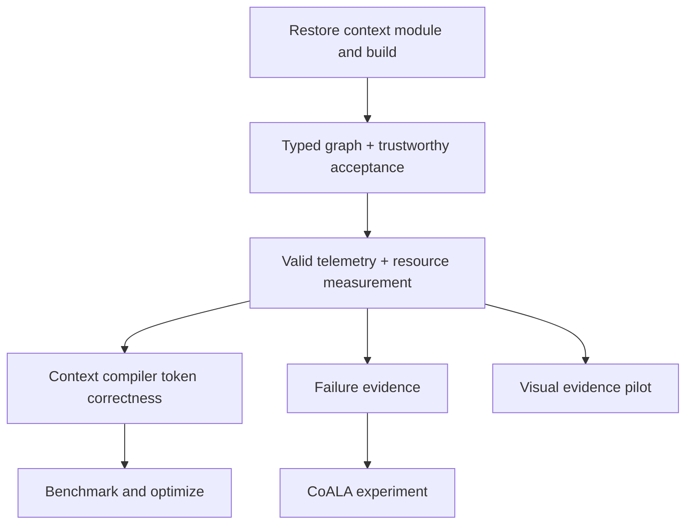

# ASEP 4.0.0-alpha — Static Engineering Audit

**Tanggal:** 26 November 2026 · **Sumber:** `asep-dev.zip` (unggahan pengguna)  
**Identitas snapshot:** komentar ZIP `4355dbc87592d49c90af9204930d5b4cc45e02b7` (40 hex; belum diverifikasi terhadap remote Git).  
**SHA-256 ZIP:** `5126e236674ac62ca28c956e9bb8f73f2bb58612401598f4080cbceab5b7ce81`

## 1. Executive summary

**Verdict: BLOCKED untuk build dan belum layak dipercaya sebagai verification gate produksi.** Modul Context Compiler tidak ada pada arsip meskipun direferensikan oleh library, CLI dan MCP. Lebih mendasar, acceptance dapat mengeluarkan evidence yang tidak terikat pada tree commit yang diuji; beberapa gate/metric menganggap hasil tidak terukur sebagai keberhasilan. Perbaiki correctness dan kualitas evidence sebelum menambah CoALA, Failure Learning, atau Visual/CV.

| Prioritas | Urutan remediasi |
|---|---|
| P0 | Pulihkan modul `context`; pastikan clean archive build; ikat evidence ke snapshot yang benar. |
| P1 | Perbaiki typed graph, test selection, gate state, resource harness, trace identity dan isolasi. |
| P2 | Perbaiki kontrak srcdump, scan coverage, konfigurasi, dan integritas message store. |
| P3 | Optimasi adjacency index, streaming, alokasi, parser worker, filtering dan build. |

## 2. Cakupan dan batas verifikasi

| Crate | File Rust (termasuk test/bench) | Baris | File di `src/` | Baris di `src/` |
|---|---:|---:|---:|---:|
| spec-engine | 113 | 27.212 | 71 | 18.296 |
| srcidx | 19 | 5.200 | 17 | 4.843 |
| srcdump | 6 | 1.835 | 5 | 1.740 |
| srcwalk | 1 | 223 | 1 | 223 |
| Total | 139 | 34.470 | 94 | 25.102 |

Arsip: 23.780 entri, 531.717.777 byte uncompressed; 17.734 file berada di `vendor/`. Inventaris mencakup seluruh empat crate. Review mendalam difokuskan pada jalur build, acceptance, graph, observability, MCP, runtime, scanner, source dumping dan harness. Bukan inspeksi semantik setiap baris dari 34 ribu baris atau audit seluruh dependency vendored. Subsystem skill manager, installer, updater, watch, snapshot, auditor, parser tiap bahasa dan E2E belum diaudit menyeluruh. Semua nomor baris di bawah berasal dari ZIP, bukan branch remote yang bergerak.

**Metode:** ekstraksi ZIP; SHA-256; pemeriksaan deklarasi modul; inspeksi source dan dokumentasi dengan nomor baris; penelusuran call site; counterexample deterministik; beberapa pemeriksaan perilaku OS/formula menggunakan Python (lampiran). `rustc` dan `cargo` tidak tersedia, termasuk nightly yang dipin pada `rust-toolchain.toml:1–4`. Karena itu **tidak ada build/test/Clippy/benchmark Rust yang diklaim telah dijalankan**. Tidak ada kode repo diubah. Audit dependency advisory, test concurrency Rust, dan pemeriksaan remote tidak dilakukan.

Label: **S** = terverifikasi statis (konsekuensi langsung source/struktur arsip); **R** = risiko dengan syarat atau kontrak yang perlu diklarifikasi; **O** = kandidat optimasi (belum dibenchmark). P0 blocker, P1 tinggi, P2 sedang, P3 rendah. Severity adalah penilaian audit, bukan CVSS. Counterexample di setiap temuan adalah rancangan regression test, kecuali yang disebut sudah diuji di lampiran.

## 3. Findings — correctness, integrity, reliability

### B01 — Context Compiler module missing [P0 · S]
- **Lokasi:** `spec-engine/src/lib.rs:10`; `spec-engine/src/mcp/tools.rs:11,1086–1091`; `spec-engine/src/runner.rs:738–756`; `docs/TDD.md:344–354`.
- **Evidence:** `pub mod context;` tetapi `spec-engine/src/context.rs` maupun `spec-engine/src/context/mod.rs` tidak ada dalam ZIP. Pencarian deklarasi modul langsung pada `lib.rs`, `main.rs`, dan `mod.rs` mengidentifikasi modul ini sebagai satu-satunya yang hilang pada pemeriksaan tersebut. Call site `compile_context` masih ada. Ini akan menimbulkan error module-not-found (E0583) saat library dikompilasi, bukan sekadar feature yang disabled. Error compiler belum dieksekusi.
- **Perbaikan:** masukkan implementasi yang sesuai FR-CTX-01/02/03 ke version control dan pastikan source tercakup dalam archive. Jangan memasukkan stub yang sekadar meloloskan build.
- **Acceptance:** clean archive `cargo check --workspace --all-targets --offline --locked`; test CLI `integration_check_test.rs:559` dan MCP `mcp_test.rs:810,869` lulus; test budget eksplisit. Verifikasi `git ls-files` pada modul di checkout asli.

### B02 — Acceptance commit tidak mengikat working tree [P0 · S]
- **Lokasi:** `spec-engine/src/acceptance_scoped.rs:39–65,91–108,144–153`.
- **Evidence:** hanya membandingkan argumen `commit` dengan `policy.approved_commit`. Sandbox membaca root working tree, bukan tree Git commit; tidak ada pemeriksaan HEAD, dirty tree, atau snapshot content. `ACCEPTED` ditulis dengan commit tersebut. Evidence tidak membuktikan bahwa commit yang dicatat benar-benar yang diuji.
- **Perbaikan:** materialisasikan immutable source snapshot dari approved commit atau verifikasi tree digest dan perubahan sebelum/sesudah; simpan hash snapshot, gate results, changed-path digest, toolchain, policy digest. Fail closed saat ketidaksesuaian.
- **Acceptance:** checkout berbeda atau dirty file → tidak ada evidence diterbitkan untuk commit yang tidak diuji; clean pinned snapshot → evidence menunjuk digest aktual.

### B03 — Scoped acceptance mengesahkan semua MUST tanpa bukti per requirement [P1 · S]
- **Lokasi:** `spec-engine/src/acceptance_scoped.rs:67–108,300–327`; `spec-engine/src/verification/mod.rs:127–150`.
- **Evidence:** setelah formal, structural, scoped test, dan fmt, seluruh ID MUST di PRD/TDD mendapat `verdict: ACCEPTED` identik. Tidak ada korelasi gate/test terhadap setiap requirement maupun review semantic. Daftar test kosong tetap melewati loop. Evaluator hanya melihat verdict, bukan cakupan.
- **Perbaikan:** pisahkan mechanical gate evidence dari semantic acceptance; hitung coverage per requirement; emit UNPROVEN untuk requirement di luar scope, unmapped atau tanpa test aktual; pertahankan reviewer dan provenance autentik.
- **Acceptance:** dua requirement independen, hanya satu teruji → requirement lain tidak otomatis ACCEPTED.

### B04 — Evidence lama dapat menutup verifikasi snapshot baru [P1 · S]
- **Lokasi:** `spec-engine/src/verification/mod.rs:41–79,83–95,119–150`.
- **Evidence:** semantic evidence hanya reviewer, verdict, rationale; behavioral hanya boolean `passed`. Tidak memvalidasi commit, digest, freshness, atau scope. `REJECTED` juga diperlakukan sama seperti missing → UNPROVEN, bukan status reject eksplisit.
- **Perbaikan:** versi schema evidence; validasi revision dan input digest; bedakan MISSING, STALE, REJECTED, PASS. Rationale non-kosong dan identitas reviewer sesuai trust model.
- **Acceptance:** reuse evidence commit A pada tree B → STALE/UNPROVEN, tidak PASS; verdict rejected tercatat eksplisit.

### B05 — Scoped test command dapat menjalankan nol test [P1 · S]
- **Lokasi:** `spec-engine/src/affected/mod.rs:451–460,511–525,568–603`; `spec-engine/src/acceptance_scoped.rs:79–83,258–270`.
- **Evidence:** `extract_function` mengembalikan nama sederhana, sedangkan unit test Rust di modul nested memakai qualified test name. `cargo test --lib -- name --exact` dapat sukses dengan 0 test. Workspace command juga tidak memilih package (`-p`), dan target yang dianggap tidak ada di-hardcode lalu dibuang.
- **Perbaikan:** gunakan Cargo metadata/target dan qualified test identifiers; output execution plan terstruktur; verifikasi selected/executed count > 0 serta failed/skipped count; fallback test target penuh dengan status eksplisit.
- **Acceptance:** fixture test dalam modul `tests::nested`, multi-crate workspace, no-match exact filter, deleted test → tidak boleh silently pass.

### B06 — Graph memvalidasi edge berdasarkan ID, bukan typed endpoint [P1 · S]
- **Lokasi:** `spec-engine/src/graph/model.rs:58–65`; `spec-engine/src/graph/builder.rs:135–189,195–214,233–270,296–347`.
- **Evidence:** COV-06 hanya memeriksa keberadaan ID; incoming counts tidak memeriksa jenis node asal. Requirement dengan edge `Satisfies` atau `Verifies` dari jenis yang tidak sesuai dapat dihitung tertutup. Edge source/target memakai string meski NodeKind berbeda. Note kosong `Some("")` dianggap ada meskipun komentar kontrak meminta non-empty note.
- **Perbaikan:** definisikan admissible `(source_kind, edge_kind, target_kind)` dari policy; resolve ambiguity eksplisit; cek `trim().is_empty()`; index hanya edge valid.
- **Acceptance:** edge dengan source/target kind tidak valid tidak menutup COV; whitespace-only note ditolak; same textual ID lintas jenis tetap terpisah.

### B07 — Impact analysis menyebar melalui semua kind dengan ID sama [P1 · S]
- **Lokasi:** `spec-engine/src/affected/mod.rs:190–212,231–253,481–499`.
- **Evidence:** edge matching membandingkan `edge.from` dengan ID tanpa kind; `resolve_id` mengembalikan seluruh kind yang memakai ID tersebut. ID tanpa deklarasi bahkan dianggap Impl. Provenance bisa menampilkan hubungan yang tidak ada secara typed; hasil false positive atau menutupi graph invalid.
- **Perbaikan:** reuse typed adjacency dari B06, validasi graph sebelum traversal; laporkan dangling reference sebagai invalid/unproven, bukan node sintetis.
- **Acceptance:** fixture same-ID Req/Impl/Test + dangling endpoint menghasilkan hanya traversal yang diizinkan oleh policy, dengan provenance yang benar.

### B08 — Scanner menelan error I/O dan dapat melaporkan graph kosong [P1 · S]
- **Lokasi:** `spec-engine/src/scanner/mod.rs:21–45,55–85`; `spec-engine/src/graph/builder.rs:355–375`.
- **Evidence:** kontrak `Returns AsepError::Io` bertentangan dengan `Err(_) => continue` pada walker, open dan line read. Jika traversal seluruhnya gagal, fungsi tetap `Ok(tags)` dan graph kosong tidak memiliki coverage violation.
- **Perbaikan:** bedakan file non-text (skip dengan alasan), permission/IO error dan missing root; report scan completeness. Hard failure untuk root invalid/required file tak terbaca.
- **Acceptance:** nonexistent root, unreadable required file, invalid UTF-8 → status eksplisit, tidak closed/PASS palsu.

### B09 — Formal gate menganggap seluruh solver skipped sebagai passed [P1 · S]
- **Lokasi:** `spec-engine/src/formal/mod.rs:59–68,95–104`; `spec-engine/src/ci/mod.rs:134–170,96–119`.
- **Evidence:** solver absent → `passed: true, skipped: true`; gate 0 tetap `passed: true, skipped: false` meskipun seluruh check skipped. Aggregate all_passed tidak membedakan coverage. Ini tidak membuktikan formal model diselesaikan.
- **Perbaikan:** explicit status PASS/FAIL/SKIPPED/UNPROVEN; policy menentukan solver wajib vs opsional; gate scope report memisahkan not-applicable dari unavailable.
- **Acceptance:** model ada dan solver absent → required formal gate bukan PASS. No model → N/A jika policy mengizinkan.

### B10 — Process memory harness mengabaikan exit status [P1 · S]
- **Lokasi:** `spec-engine/src/harness/process.rs:210–244`.
- **Evidence:** `Ok(Some(_)) => break` membuang status exit; fungsi bisa mengembalikan Ok untuk command gagal selama peak RSS di bawah limit.
- **Perbaikan:** cek `status.success()`, capture bounded diagnostics, bedakan execution error dari budget violation.
- **Acceptance:** program yang exit nonzero selalu error, terlepas dari peak RSS.

### B11 — Child stdout pipe tidak dikuras sebelum wait [P1 · S]
- **Lokasi:** `spec-engine/src/harness/process.rs:55–105,124–134,210–244`.
- **Evidence:** child stdout dipipe; `run_once` menunggu exit sebelum membaca pipe. Child dengan output lebih besar daripada kapasitas pipe dapat terblokir; pada memory harness pipe bahkan tidak dibaca. False timeout bukan pelanggaran kompleksitas atau memory.
- **Perbaikan:** concurrent bounded drain stdout/stderr, atau redirect ke sink/file bila tidak dibutuhkan; enforce process deadline dan cleanup.
- **Acceptance:** program sukses yang mengeluarkan 1 MiB teks tetap selesai; output limit eksplisit.

### B12 — Peak RSS bukan peak process tree; platform unsupported memberi 0 [P1 · S]
- **Lokasi:** `spec-engine/src/harness/process.rs:53–70,175–205,215–236`.
- **Evidence:** PID yang diukur adalah shell; child proses terpisah tidak dihitung. Polling 10 ms dapat melewatkan proses singkat; `/proc` tidak tersedia dan platform non-Linux menghasilkan 0, lalu 0 diterima sebagai pengukuran valid.
- **Perbaikan:** Linux process-group/cgroup accounting atau metric subprocess tree; platform unsupported → UNAVAILABLE; simpan method dan completeness. Bedakan RSS dari aggregate memory (shared pages).
- **Acceptance:** child dengan alokasi besar di bawah shell terdeteksi; unsupported platform tidak mengeluarkan 0-byte pass palsu.

### B13 — Scoped thread timeout tidak membatasi wall-clock [P1 · S]
- **Lokasi:** `spec-engine/src/harness/asymptotic.rs:41–57`.
- **Evidence:** `recv_timeout` mengembalikan Err, tetapi `std::thread::scope` wajib join seluruh thread sebelum keluar. Jika closure masih berjalan, fungsi tetap menunggu (tak terbatas untuk closure yang tidak selesai).
- **Perbaikan:** cooperative cancellation untuk in-process workload, isolated process dengan deadline untuk hard timeout; jangan menjanjikan forced cancellation Rust thread.
- **Acceptance:** workload 500 ms dengan timeout 20 ms; kontrak hard timeout diuji dengan batas wall-clock toleran. Bila cooperative, label dan perilaku harus eksplisit.

### B14 — Complexity measurement menyamakan step count dan waktu [P2 · R]
- **Lokasi:** `spec-engine/src/harness/process.rs:108–172`; `spec-engine/src/harness/asymptotic.rs:62–93`.
- **Evidence:** satu pengamatan per N, fallback microseconds jika `steps` tidak valid, termasuk startup overhead; dapat mencampur unit antar N. `max_slope` nonfinite tidak ditolak di API, NaN membuat perbandingan false.
- **Perbaikan:** fixed metric mode, finite nonnegative bound, warmup/repetition dan confidence interval; jika input duplicate atau metric inconsistent, reject.
- **Acceptance:** mixed metrics dan NaN → error; workload linear dan quadratic diukur pada geometric sizes dengan repeat dan baseline noise.

### B15 — Observation kehilangan task identity [P1 · S]
- **Lokasi:** `spec-engine/src/runtime/react.rs:19–28,57–75,138–152`; `docs/TDD.md:312`.
- **Evidence:** `task_id: String::new()`; test hanya mengecek trace_id, seq, detail. Kontrak eksplisit task IDs tidak terpenuhi. `Observation` juga tidak membawa task_id untuk dipertahankan.
- **Perbaikan:** bawa `task_id` lewat typed observation/span context, validasi nonempty, pastikan correlation ID/action seq sesuai.
- **Acceptance:** dua task dalam trace sama tidak tergabung dalam bucket kosong; invalid identity ditolak.

### B16 — Trace summary mencampur trace yang berbagi prefix [P1 · S]
- **Lokasi:** `spec-engine/src/mcp/tools.rs:1108–1138`; `spec-engine/src/runner.rs:2281–2294`; `spec-engine/src/observability.rs:410–428`.
- **Evidence:** `starts_with(trace_id)` memilih trace lain yang memiliki prefix sama. Parser rotated segment juga menggunakan prefix longgar dan tidak memvalidasi grammar timestamp. Report dapat mencampur hasil berbeda; purge/retention dapat salah memilih segmen dengan ID bertitik.
- **Perbaikan:** encode ID sebagai safe opaque key; pakai exact filename untuk active dan parser segment yang tidak ambigu; validasi event.trace_id; satu shared reader.
- **Acceptance:** trace `run1` dan `run10` dilaporkan terpisah; rotated segment trace berbeda tidak terhapus oleh purge.

### B17 — Telemetry default allowlist kosong menghasilkan event kosong [P1 · S]
- **Lokasi:** `spec-engine/src/config/settings.rs:68–78`; `spec-engine/src/observability.rs:310–328,580–598`.
- **Evidence:** default allowlist `Vec::new()`. Serializer hanya memasukkan field jika allowlist tidak kosong dan mengandung key; default menjadi `{}`. `record_evidence()` memang sengaja bypass ordinary telemetry-off sesuai TDD:326, tetapi evidence-nya tidak bermakna jika allowlist default.
- **Perbaikan:** default allowlist untuk schema minimum dan evidence yang diizinkan; enforce mandatory IDs; field payload sensitif opt-in. Jangan mengganti empty allowlist menjadi allow-all tanpa privacy review.
- **Acceptance:** default evidence berisi schema_version, trace_id, task_id, event, seq dan detail evidence yang disetujui; raw secrets tidak ikut.

### B18 — Metrik trace salah definisi dan report canonical tidak dipakai [P1 · S]
- **Lokasi:** `spec-engine/src/observability.rs:65–79,86–183,186–209`; `spec-engine/src/runner.rs:2281–2335`; `spec-engine/src/mcp/tools.rs:1106–1182`; `docs/PRD.md:83`; `docs/TDD.md:305–306`.
- **Evidence:** gate pass rate = substring `pass` / seluruh event; token_count = jumlah event bernama token, bukan token yang dipakai; cost denominator = semua event berisi cost object, termasuk value None; latency tanpa duration dapat menjadi 0. Nama `observation` dengan ok=false tidak muncul dalam failures. `TraceReport::from_events` hanya ditemukan dipanggil oleh unit test di source saat ini; CLI/MCP menghitung count sendiri, bukan canonical report.
- **Perbaikan:** typed event/result, denominators sesuai measurement domain, source/units/currency dan missingness eksplisit; reuse CiReport/CheckJsonReport; satu report builder untuk CLI/MCP.
- **Acceptance:** 1 pass + 1 fail gate + 8 unrelated event → gate pass rate 0.5 bukan 0.1; 500 tokens → 500; unknown cost/duration → None; failed observation tercatat. CLI/MCP parity.

### B19 — Rotasi trace per detik dapat menimpa segmen lama [P1 · S]
- **Lokasi:** `spec-engine/src/observability.rs:338–369`.
- **Evidence:** nama rotated file mengandung epoch seconds; dua rotasi trace yang sama dalam satu detik menghasilkan destination yang sama. Pada Unix rename dapat mengganti file lama. Ukuran limit diperiksa sebelum batch, bukan ukuran aktual sesudah append.
- **Perbaikan:** unique monotonic segment ordinal + atomic create/rename yang tidak overwrite, cap berdasarkan serialized bytes; sink single writer atau lock antarproses.
- **Acceptance:** beberapa rotasi di detik yang sama dengan max_bytes kecil tetap mempertahankan seluruh sequence unik.

### B20 — Trace persistence tidak aman terhadap partial write dan mode file awal [P1 · R]
- **Lokasi:** `spec-engine/src/observability.rs:338–371,452–457,431–448`.
- **Evidence:** seluruh batch tetap di buffer sampai akhir; jika sebagian write berhasil lalu error, retry/Drop dapat menulis duplikat. Permission 0600 baru disetel setelah write, sehingga file baru mengikuti umask sampai saat itu. TTL hanya memproses rotated segment saat flush trace terkait, bukan active atau trace idle.
- **Perbaikan:** buat file dengan mode aman sejak awal; commit boundary dengan event ID/dedup dan recovery tail; bounded retention sweep lintas trace; tentukan durability requirement (flush vs fsync).
- **Acceptance:** fault injection write error dan restart tidak menduplikasi event committed; default file mode aman; idle trace retention sesuai policy.

### B21 — Capability validation fail-open untuk config rusak dan nama tak dikenal [P1 · S]
- **Lokasi:** `spec-engine/src/config/settings.rs:82–115,120–159,190–200`; `spec-engine/src/runtime/react.rs:32–54`.
- **Evidence:** unknown capability diabaikan oleh `missing`; config rusak/unreadable kembali ke default yang mengaktifkan seluruh capability. `ActionContract` hanya memeriksa daftar capability yang diberikan caller, bukan requirement canonical per tool. Ini bukan enforcement boundary yang fail-closed.
- **Perbaikan:** pisahkan missing config dari malformed config; error untuk config invalid/unknown capability; derive required capabilities dari trusted tool registry. Tegaskan batas antara advisory policy dan runtime enforcement.
- **Acceptance:** malformed profile restrictive tidak memberi izin luas; unknown capability tidak dianggap satisfied.

### B22 — BudgetTracker menerima cost invalid [P2 · S]
- **Lokasi:** `spec-engine/src/runtime/budget.rs:26–76`.
- **Evidence:** `record_cost` menerima negative, NaN dan infinity tanpa validasi; NaN membuat `cost_usd > limit` false. Counter juga diperiksa setelah penggunaan, bukan reservation sebelum operasi; batas pas tidak memblokir action berikutnya.
- **Perbaikan:** finite/nonnegative cost dan max cost; jika memerlukan strict cap, reserve sebelum action lalu reconcile actual. Pertimbangkan integer micro-unit untuk monetary tracking, jangan berpura-pura mengetahui biaya sebelum provider report.
- **Acceptance:** invalid costs rejected; budget exhausted tidak mengizinkan next reserved action.

### B23 — MessageStore write dan ack tidak atomik secara transaksi [P1 · R]
- **Lokasi:** `spec-engine/src/agent_protocol/mod.rs:224–243,288–306,328–340,553–564`.
- **Evidence:** ID check-then-use; body dan envelope dua rename terpisah, crash dapat menyisakan body orphan; concurrent ack read-modify-write tanpa lock/CAS; temporary filename tetap untuk satu target. Race membutuhkan beberapa writer atau crash.
- **Perbaikan:** unique temp file create_new, publish message transaction melalui atomic directory/manifest commit, per-message serialization atau CAS; status transition monotonic sesuai state machine.
- **Acceptance:** 100 parallel sends, parallel ack terhadap satu message, fault injection antara write body/envelope → tidak ada accepted partial state atau lost update.

### B24 — Envelope directory validator tidak mendeteksi duplicate ID dan filename mismatch [P2 · S]
- **Lokasi:** `spec-engine/src/agent_protocol/mod.rs:170–192,449–500`.
- **Evidence:** hasil `ids.insert` diabaikan; envelope.id tidak dibandingkan filename; validasi body memakai envelope.id, bukan stem file. Two envelopes dapat memakai identitas sama tanpa error duplicate (jika body valid).
- **Perbaikan:** reject duplicate, enforce canonical ID grammar dan file stem equality, validasi reference/reply_to sebelum publish, laporkan unreadable entries.
- **Acceptance:** duplicate envelope ID, mismatched filename, orphan reply → validator gagal eksplisit.

### B25 — Traceability tag lexer menerima partial match dan invalid priority [P2 · S]
- **Lokasi:** `spec-engine/src/scanner/lexer.rs:62–70,79–125,128–158,173–185`.
- **Evidence:** regex tidak enforce batas akhir tag; priority tidak dikenal default MUST. Malformed suffix dapat dianggap tag valid prefix. Scanner mengambil tags dari semua line, termasuk quoted contoh, sehingga source test/doc dapat ikut terhitung.
- **Perbaikan:** lex grammar dengan delimiter dan diagnostic; explicit parse error untuk unknown priority; bedakan declaration dari contoh sesuai format bahasa/documentation.
- **Acceptance:** unknown priority dan malformed relation tidak berubah diam-diam menjadi valid tag; fixture quoted example tidak mendeklarasikan requirement jika policy melarang.

### B26 — srcdump Rust comment stripper menghapus source non-comment [P1 · S]
- **Lokasi:** `srcdump/src/formatter.rs:407–449,454–474`.
- **Evidence:** caller `skip_block_comment` dipanggil pada tiap posisi yang bukan string/char/line comment. Fungsi langsung `i += 2; depth = 1` tanpa memastikan prefix `/*`, padahal doc menyatakan caller harus memastikan. Source biasa sebelum sebuah block comment bisa ikut hilang; penghapusan comment tanpa separator juga dapat menyatukan token.
- **Perbaikan:** cek prefix sebelum scanning; preserve whitespace/newline yang semantik; pertimbangkan reuse parser existing, bukan scanner kedua yang tidak lengkap.
- **Acceptance:** `let a = 1; /* comment */ let b = 2;` mempertahankan kedua statement; nested comment, string, Unicode, unterminated comment dan token adjacency fixtures.

### B27 — srcdump output format tidak dipatuhi [P2 · S]
- **Lokasi:** `srcdump/src/main.rs:22–28,55–61,166–176`; `srcdump/src/formatter.rs:188–225`; `spec-engine/src/mcp/tools.rs:703–706`.
- **Evidence:** CLI menyediakan NDJSON/JSON/Text; Formatter selalu menulis header JSON diikuti JSON per file, tidak membaca `config.format`. JSON output beberapa file bukan satu JSON document.
- **Perbaikan:** implement format dispatch atau hilangkan opsi yang belum didukung dengan explicit unsupported error; satu contract untuk CLI/MCP.
- **Acceptance:** JSON mode dapat diparse sebagai satu document; text mode bukan NDJSON; NDJSON setiap line valid.

### B28 — srcdump token/metadata tidak merepresentasikan hasil output [P1 · S]
- **Lokasi:** `srcdump/src/formatter.rs:189–251,263–279,574–577`; `docs/CONTEXT_COMPILER_RESULTS.md:11–15,38–40`.
- **Evidence:** total_tokens_est selalu 0; token count dihitung pada content original walau output strip/truncate/summary; `files` dihitung sebelum silent omissions oleh process_file; tokens per output tidak dihitung. Dokumentasi spike sudah menyatakan caveat ini. Context Compiler budget tidak boleh menganggap angka ini actual emitted context.
- **Perbaikan:** bedakan original_tokens dan emitted_tokens; sertakan serialized wrapper/metadata bila target budget final prompt; stream trailer totals atau prepass jika header wajib. Emit skipped count/reason, jangan menghilangkan file tanpa status.
- **Acceptance:** file 1000 lines dengan summary 100 lines menunjukkan dua metric berbeda dan aggregate sesuai output nyata; input unreadable dicatat.

### B29 — srcdump symbol-only/signature mode dan konfigurasi diabaikan [P2 · S]
- **Lokasi:** `srcdump/src/main.rs:79–129,157–202`; `srcdump/src/config.rs:125–170`; `srcdump/src/formatter.rs:212–269,305–308,553–577`.
- **Evidence:** mode SymbolsOnly/Signatures memproduksi content kosong tetapi symbol extraction hanya jika include_symbols true (default CLI false). `jobs`, `estimate_tokens`, `summary_threshold`, `use_default_includes` tidak dipakai dalam jalur formatter/config filtering terkait. Config TOML ditimpa CLI defaults walaupun opsi tidak diberikan; `--no-default-includes` tidak mengosongkan default list.
- **Perbaikan:** explicit CLI precedence dengan Option/ValueSource; mode menentukan metadata required; implement atau hapus flags no-op; local Rayon pool yang menghormati jobs; gunakan threshold sebenarnya.
- **Acceptance:** tanpa flag ekstra signatures memuat signature; TOML custom mode dipertahankan; jobs=1 benar-benar satu worker; threshold berubah mempengaruhi mode summary yang didokumentasikan.

### B30 — srcdump symlink safety guard tidak pernah mengenali symlink valid [P1 · S]
- **Lokasi:** `srcdump/src/walker.rs:51–60,101–149`; `srcdump/src/config.rs:149`.
- **Evidence:** `fs::metadata` mengikuti symlink, lalu memeriksa `file_type().is_symlink()`. Untuk symlink valid ke regular file, hasil metadata adalah regular file, fungsi kembali false sebelum containment check. Selain itu symlink directory telah dilewati sebagai directory, tetapi traversal anak bisa terjadi. Default follow true.
- **Perbaikan:** default follow false; cek canonical containment terhadap root pada traversal sebelum descend dan setiap file; gunakan symlink_metadata untuk identitas link. Samakan policy dengan srcwalk, tolak special files.
- **Acceptance:** fixture link ke target internal, external, circular, directory alias; external tidak dibaca dan tidak ada silent escape.

### B31 — srcwalk gitignore switch tidak mengontrol .gitignore [P2 · S]
- **Lokasi:** `srcwalk/src/lib.rs:50–60`; vendor reference `vendor/ignore/src/walk.rs:890–934`.
- **Evidence:** builder.ignore mengatur `.ignore`, bukan `.gitignore`; `git_ignore`, `git_global`, dan `git_exclude` adalah API berbeda. Config false tidak otomatis mematikan git-specific ignore. `add_ignore` result juga diabaikan.
- **Perbaikan:** define `respect_gitignore` semantics; set semua flag terkait secara eksplisit dan propagate ignore parse errors; test repository dan archive tanpa `.git`.
- **Acceptance:** fixture .gitignore mengabaikan file hanya pada enabled; invalid custom ignore menghasilkan diagnostic.

### B32 — srcwalk follow symlinks dan dedup tidak sesuai kontrak [P2 · S]
- **Lokasi:** `srcwalk/src/lib.rs:79–85,100–123,149–158`.
- **Evidence:** symlink_metadata pada link file memberi is_file=false walaupun follow_symlinks=true; direct link file selalu dilewati. `seen` hanya insert canonical directory tetapi hasil insert tidak digunakan, tidak pernah prune walker. Alias path dapat mengulang pemrosesan; sort/dedup hanya lexical path.
- **Perbaikan:** definisikan follow semantics yang konsisten; enforce containment dan canonical dedup jika dimaksudkan; rely pada walker cycle detection dengan handling error eksplisit.
- **Acceptance:** link internal regular file sesuai opsi; multiple aliases tidak menjadi duplicate logical file bila canonical dedup dijanjikan.

### B33 — Truncation max-line-length melampaui batas [P3 · S]
- **Lokasi:** `srcdump/src/formatter.rs:514–540`.
- **Evidence:** mengambil `max_len/2` karakter dari awal dan akhir, lalu menambah 3 titik. max_len=10 → 13 karakter; max_len=9 → 11. max_len<4 tidak menerapkan limit sama sekali.
- **Perbaikan:** hitung budget setelah ellipsis; document apakah chars, bytes atau grapheme; preserve UTF-8 dan trailing newline contract.
- **Acceptance:** property test semua panjang Unicode dan limit 0..N; output tidak melewati batas yang dijanjikan.

### B34 — JSON-RPC request validation tidak lengkap [P2 · S]
- **Lokasi:** `spec-engine/src/mcp/protocol.rs:8–15`; `spec-engine/src/mcp/server.rs:14–29,31–68,76–93`.
- **Evidence:** versi jsonrpc tidak diperiksa, ID object/array dapat diterima, error deserialize schema request diperlakukan parse error -32700 meski JSON syntactically valid, input I/O error dianggap EOF. Notification selalu langsung return tanpa processing.
- **Perbaikan:** pisahkan parse, schema, method/params error; validate protocol version and ID type; define supported notifications; propagate stdin IO error. Tool errors gunakan MCP tool result vs JSON-RPC error sesuai kontrak protocol.
- **Acceptance:** invalid JSON, invalid request version, invalid ID, unknown method, bad args, valid notification diuji terpisah.

### B35 — Windows build portability blocker [P2 · S, jika Windows target didukung]
- **Lokasi:** `spec-engine/src/observability.rs:6,367–368`; `spec-engine/src/harness/process.rs:53–64,201–205`.
- **Evidence:** `std::os::unix::fs::PermissionsExt` tanpa cfg membuat library tidak dapat compile pada Windows. Sebagian harness justru memiliki cabang Windows. Scoped acceptance sendiri Linux-specific; bukan bug bila proyek resmi hanya Linux, tetapi perlu target support eksplisit.
- **Perbaikan:** conditional platform implementation atau deklarasikan Linux/Unix-only; Windows ACL bukan sekadar pengganti mode Unix. Platform CI sesuai support matrix.
- **Acceptance:** supported target `cargo check` lulus; unsupported platform memberi diagnostic jelas pada feature yang tidak tersedia.

## 4. Kandidat optimasi tingkat lanjut (belum benchmark)

Prinsip: optimasi tidak boleh mengubah correctness atau menambah subsystem redundan. Kompleksitas di bawah berasal dari loop source, bukan hasil pengukuran Rust.

| ID | Lokasi | Bottleneck | Rekomendasi dan trade-off |
|---|---|---|---|
| O01 | `spec-engine/src/affected/mod.rs:85–113,118–163,190–269,481–499` | Scan graph berulang: setiap visited node menelusuri seluruh E, resolve_id menelusuri V; worst-case jauh dari BFS linear. Queue awal `queue`/`visited`/`reached_ids` tidak dipakai untuk traversal sebenarnya. | Build `NodeKey -> NodeId`, `path -> IDs`, outgoing/incoming adjacency sekali; hapus queue dead work. Traversal O(V+E) dengan typed indexing; biaya membangun index dan memori O(V+E). |
| O02 | `spec-engine/src/affected/mod.rs:142–163,206–212,247–253` | Clone seluruh provenance chain di setiap hop, lalu disimpan di map dan queue. Chain panjang dapat O(V²) total materialized hops. | Simpan predecessor+edge sekali per visited node; reconstruct saat emit. Output full provenance masih bisa O(V²), gunakan compact predecessor report jika konsumen setuju. |
| O03 | `spec-engine/src/graph/builder.rs:284–293`; `spec-engine/src/affected/mod.rs:373–435,511–525,607–621` | Linear search tag/node berulang; file test dibaca ulang per tag; manifest parse per command. | Index requirement priority dan node by ID; cache line index per file serta Cargo metadata per crate. Hindari cache global sampai perlu lintas request; invalidation berdasarkan revision/content. |
| O04 | `spec-engine/src/observability.rs:330–341,358–370,580–619` | Tiap event menjumlah panjang seluruh bucket; flush clone event batch, serialize Value + filter + string, syscall write berulang. | O(1) pending_count, detach batch dengan recovery ownership, BufWriter, typed serialize filtered fields, precompile redaction matcher bila pattern banyak. Retain durability dan privacy tests. |
| O05 | `spec-engine/src/observability.rs:478–507`; `spec-engine/src/agent_protocol/mod.rs:533–541` | Hash membaca seluruh file ke Vec, rehash seluruh path per checkpoint. | Streaming SHA-256 dengan bounded buffer; cache per file hanya jika change detection yang sound. Metadata mtime/size saja bukan bukti content identity. |
| O06 | `srcdump/src/formatter.rs:140–171,212–251,335–387,580–595`; `srcidx/src/parser/mod.rs:204–220` | Parser registry satu write lock per language → parallel files bahasa sama serialize saat extraction. Tokenizer dan queries dibuat walau tidak dibutuhkan; read full content sebelum truncation. | Per-worker parser registry atau pool bounded; lazy initialize query/tokenizer; parse sekali dan reuse tree bila cocok; weight chunks berdasarkan bytes, bukan 256 file tetap. Memory bertambah per worker; benchmark mixed vs single-language. |
| O07 | `srcwalk/src/lib.rs:51–60,85–158`; `srcdump/src/walker.rs:13–98`; `srcdump/src/config.rs:420–440` | Dua implementasi filter, glob exclusion post-walk; vendor dan target directory tetap dapat ditelusuri sebelum dibuang. File dibaca untuk binary sniff lalu dibaca lagi. | Satukan walker contract; pre-descent prune excluded directories dengan ignore semantics; gabungkan sniff/read untuk text bila memungkinkan. Jangan mengorbankan reinclusion semantics. |
| O08 | `spec-engine/src/mcp/tools.rs:669–688,1113–1182,1264–1273`; `srcidx/src/main.rs:98–164` | Full response materialization, NDJSON di-escape menjadi JSON string; raw trace events di-collect walau summary cukup. | Page/byte budget, summary-only default opsional, streaming NDJSON ke writer/file, bounded MCP response; no silent truncation, explicit cursor and counts. Header determinism harus dijaga. |
| O09 | `spec-engine/src/acceptance_scoped.rs:56–65,218–226,329–339` | Fresh scratch target tiap acceptance menyebabkan cold builds dan scratch tidak dihapus. create_dir_all juga sukses untuk directory existing, sehingga bukan reservasi unik. | RAII scratch lifecycle (unique create_dir); cleanup pada error; trusted compiler cache yang dipisah dari untrusted writable build state. Cache key meliputi toolchain, lockfile, target, flags, snapshot. |
| O10 | `spec-engine/Cargo.toml:20–45`; `Cargo.toml:31–48`; `rust-toolchain.toml:1–4` | CLI, HTTP updater, parser grammar, tokenizer dan test/bench dependency satu workspace build graph; nightly pinned. Dev/test debug deps sudah dioptimasi. | Ukur `cargo tree -e features`, timings dan target size dulu. Feature-gate optional updater/network/UI tooling jika benar mengurangi critical path; split targets hanya bila ada bukti. Bandingkan incremental warm/cold, test binary size dan release runtime. Jangan pindah bahasa, ganti allocator, atau pakai unsafe tanpa data. |

### Benchmark matrix (rencana, bukan hasil)

| Workload | Variasi | Metrik | Acceptance |
|---|---|---|---|
| Graph + affected | V=100, 1k, 10k; sparse, dense, cyclic, same-ID | median/p95 latency, allocations, RSS, identical impacted IDs | traversal scaling membaik; typed output benar dan stable |
| Trace collector | 10k/100k events, 1/100/1k trace IDs, varying payload | throughput, disk bytes, allocations, duplicate/missing sequence | exact evidence dan redaction; overhead dibanding baseline yang sama |
| Source dump | 1/4/8 workers, homogeneous/mixed languages, large file | wall-clock, peak RSS, emitted tokens, output equivalence | throughput membaik tanpa menghilangkan file/symbol |
| Acceptance | cold/warm clean target, changed subset | compile/test wall time, cache hit, disk bytes, test executed count | no stale evidence, no zero-test success, scratch cleaned |
| MCP | small, medium, oversized input | payload bytes, response latency, peak RSS, truncation rate | explicit status and bounded output |

Gunakan release build untuk runtime benchmark, warmup, randomized/balanced order, minimal 10–30 sampel untuk latency distribution jika biaya memungkinkan. Bandingkan commit dan fixture yang sama; jangan mengklaim p95 dari tiga sampel. Profiling sebelum dan sesudah; satu perubahan independen per pengukuran.

## 5. Implikasi empat capability

| Capability | Status audit snapshot | Blocking dependencies |
|---|---|---|
| Context Compiler | CLI/MCP/PRD/TDD ada, implementasi module tidak ada | B01, B05–B08, B26–B29, O01–O03 |
| Failure Learning | Dokumen ada; validitas evidence belum cukup untuk otomatisasi learning | B02–B04, B09–B20 |
| CoALA Memory | Dokumen eksperimen tersedia, implementasi persistensi spesifik tidak diverifikasi | trace identity, evidence freshness, message transaction, provenance |
| Visual/CV | Dokumen eksperimen tersedia; belum ada bukti audit runtime visual | capability validation, evidence schema, external workload acceptance |

Urutan dependency yang disarankan:



## 6. Reproduction / gate checklist untuk checkout asli

Jalankan setelah memperbaiki B01, pada environment Rust yang mendukung nightly pinned dan vendored dependency. Semua command berikut adalah **rencana verifikasi**, tidak dijalankan dalam audit ini.

```sh
cargo check --workspace --all-targets --offline --locked
cargo fmt --all --check
cargo clippy --workspace --all-targets --offline --locked -- -D warnings
cargo test --workspace --offline --locked
cargo test -p asep --test integration_check_test --offline --locked
cargo test -p asep --test mcp_test --offline --locked
cargo test -p asep --lib observability --offline --locked
cargo test -p asep --test affected_test --offline --locked
cargo test -p asep --test graph_test --offline --locked
cargo test -p asep --test acceptance_scoped_test --offline --locked
cargo test -p asep --lib harness --offline --locked
cargo test -p srcdump --offline --locked
cargo test -p srcwalk --offline --locked
cargo test -p srcidx --offline --locked
cargo tree --workspace -e features --offline --locked
```

Setiap bug membutuhkan minimal satu regression test yang gagal sebelum fix dan lulus setelah fix. Untuk gate, audit **test executed count**, bukan exit code saja. Untuk concurrency gunakan parallel integration tests dan fault injection; Loom hanya model concurrency yang sesuai, bukan otomatis proof semua filesystem race. Untuk parser gunakan fixture multibahasa, UTF-8, generated corpus dan differential testing. Untuk security boundary path/permissions, gunakan hanya temporary directory fixture dan data dummy.

## 7. Additional review backlog (tidak diklaim bug terverifikasi)

- `spec-engine/src/skill/` dan `spec-engine/src/pack/`: version resolution, rollback, remote source trust, atomic install, path containment dan integrity; belum ditelusuri semua operasi.
- `spec-engine/src/self_update.rs`: artifact signature, platform matrix, transactional update; perlu audit terpisah.
- `spec-engine/src/watch/mod.rs`, `snapshot/mod.rs`, `coverage/mod.rs`: event coalescing, stale state, incremental invalidation dan parser coverage.
- `srcidx/src/parser/`: compare per-language AST semantic extraction, error recovery, qualification, scope dan Unicode span; perlu golden corpus setiap bahasa.
- `spec-engine/src/auditor/`: false-positive/negative rate, rule complexity, canonical policy compatibility.
- `spec-engine/src/mcp/server.rs`: message size cap dan cooperative cancellation; evaluate real client protocol compatibility.
- Dependency audit: `Cargo.lock`, advisories, feature surface, license and vendor integrity; tidak ada advisory/security database yang diperiksa dalam audit offline ini.

## 8. Kesimpulan

Temuan utama bukan kurangnya fitur atau kurangnya Rust optimization, melainkan *proof integrity*: hasil verifikasi harus dapat dibedakan dari hasil tidak teruji. Gunakan typed identifiers, explicit state, immutable input identity dan satu jalur evidence/report. Pertahankan arsitektur Rust dan reuse komponen yang ada; perubahan besar baru dibenarkan setelah regression test serta benchmark membuktikan manfaatnya. Tidak mungkin mengklaim semua bug sudah ditemukan dari review statis, terlebih source Context Compiler tidak disertakan.

## Lampiran A — Pemeriksaan yang benar-benar dieksekusi

Berikut hasil pemeriksaan Python terhadap arsip, formula yang disalin dari source, dan perilaku OS. Ini **bukan eksekusi program Rust ASEP**. Hasil Rust regression suite masih pending.

| Check | Hasil | Observasi |
|---|---|---|
| B01 archive structure | PASS | No context.rs or context/ entry in ZIP. |
| Snapshot identifier | PASS | ZIP comment matches reported snapshot ID. |
| B16 prefix predicate | PASS | A trace lookup for run1 incorrectly selects all three filenames including run10. |
| B17 allowlist predicate | PASS | Empty allowlist serializes no fields under equivalent predicate. |
| B18 rate arithmetic | PASS | Current formula 0.1 vs gate-only 0.5. |
| B19 OS rename semantics | PASS | Second rename replaces existing destination on this Linux filesystem. |
| B30/B32 OS metadata semantics | PASS | Following metadata identifies target as regular; no-follow metadata identifies symlink. |
| B22 NaN comparison | PASS | NaN > finite budget is false under IEEE comparison. |
| B26 comment scan predicate | PASS | Model returns index 12 when started at semicolon (not comment), deleting non-comment semicolon. |
| B33 truncation arithmetic | PASS | Configured 10 characters -> 13 in current construction. |
| B11 OS pipe behavior | PASS | A local 1 MiB stdout producer cannot exit while parent waits without draining the pipe. |

Pemeriksaan otomatis path dan range awal pada 81 referensi source dalam laporan: tidak ada referensi di luar panjang file atau path tidak ditemukan. Pemeriksaan ini memastikan lokasi tersedia, bukan proof otomatis bahwa seluruh interpretasi semantik benar.
