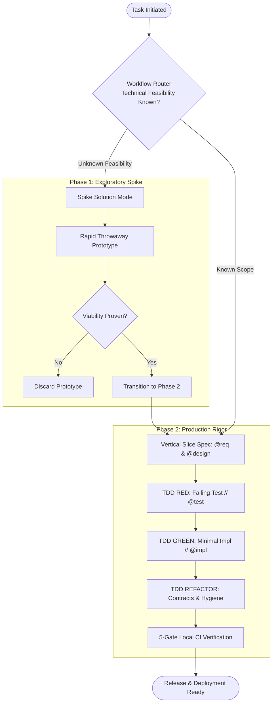

# ASEP: Axiomatic Systems Engineering Protocol

> Spec-Driven Extreme Programming (FXP) engineering protocol featuring a two-phase SDLC, 1:1 closed-loop traceability, multi-language contracts, formal methods (Alloy/TLA+), and high-performance Rust deterministic validation.

---

<!-- @gov:README-SUMMARY -->
## Overview

`ASEP` (Axiomatic Systems Engineering Protocol) formalizes an autonomous, sovereign software engineering discipline that removes administrative overhead during exploratory phases while enforcing mathematical rigor during stabilization. The framework implements ISO/IEC/IEEE 29148 requirements grammar, canonical PlantUML visual modeling, idiomatic Design by Contract across five programming languages (Rust, TypeScript, Python, Go, C/C++), zero-dependency repository governance, Diátaxis + Progressive Disclosure manuals (`MANUAL.md`), and a native Rust verification engine (`asep`).

---

<!-- @gov:README-PREREQ -->
## Target Platforms

### Supported Operating Systems
Linux (x86_64, aarch64), macOS (Apple Silicon, x86_64), Windows (x86_64)

---

## Prerequisites

### Rust Version (MSRV)
Rust 1.80.0+ (Edition 2021)

### Core Toolchain
cargo and rustc (official Rust toolchain)

### Optional Diagram Tools
plantuml and graphviz (for local .puml compilation to SVG vector assets)

---

<!-- @gov:README-HIGHLIGHTS -->
## Architecture Highlights

### Isolated Two-Phase SDLC (Spec-Driven XP)
Strict separation between Phase 1 (Exploratory Spike), where linter and tag requirements are disabled to allow rapid hypothesis testing without bureaucracy, and Phase 2 (Production Rigor), which mandates strict Test-Driven Development (TDD), Systematic Debugging, and 5-Gate CI automated verification.

### Closed-Loop 1:1 Traceability Graph
Every functional requirement (`@req:*:MUST`) is deterministically bound 1:1 to production code interfaces (`// @impl`) and automated test assertions (`// @test`), validated by `asep check`.

### Idiomatic Design by Contract (SWEBOK 4.4)
Native contract documentation conventions per language ecosystem (Rust `///`, TypeScript TSDoc `@remarks`, Python Google Style `Invariants:`, Go godoc declarative statements, C++ Doxygen `@invariant`) governed by Strict Conditionality (zero phantom sections, zero signature parroting).

### Dual Visual Modeling & Formal Methods
Formal architectural models: Use Case and Activity for PRDs; Denert 1991 Boundary-Control-Entity (BCE) Sequence and Class diagrams compiled to vector SVG for TDDs; backed by Alloy (`.als`) and TLA+ (`.tla`) mathematical invariant proofs.

### 5-Gate Local CI Verification Pipeline
Five deterministic quality gates: Gate 0 Formal Specs, Gate 1 Symmetrical Traceability (`asep check`), Gate 2 Static Analysis (`clippy -D warnings`), Gate 3 Test & Fuzz Suite, and Gate 4 Continuous Performance Budgeting.

### Two-Phase SDLC Architecture



### Canonical Protocol Modules & Skills

The ASEP architecture comprises five self-contained domain skills orchestrated by the Master Dispatch Router:

| Protocol Module | Scope & Responsibility | Canonical Specification | Autonomous AI Skill |
| :--- | :--- | :--- | :--- |
| **System-Architecture** | **Core Architecture & Systems Engine**<br>PRD/TDD lifecycle, two-phase SDLC, Rich ADRs, 1:1 traceability graph closure. | [`system-architecture/system-architecture.md`](system-architecture/system-architecture.md) | [`system-architecture`](system-architecture/skill/SKILL.md) |
| **Workflow-Router** | **Master Agent Dispatch & Skill Orchestrator**<br>Self-contained dynamic routing across all internal ASEP protocols. | [`workflow-router/workflow-router.md`](workflow-router/workflow-router.md) | [`workflow-router`](workflow-router/skill/SKILL.md) |
| **Engineering-Specs** | **Technical Authoring & Specifications**<br>ISO/IEC/IEEE 29148:2018 requirements grammar, four canonical PlantUML diagrams. | [`engineering-specs/engineering-specs.md`](engineering-specs/engineering-specs.md) | [`engineering-specs`](engineering-specs/skill/SKILL.md) |
| **Code-Contracts** | **Code-Level Operational Contracts**<br>Anti-parroting heuristics, strict conditionality, multi-language contract templates. | [`code-contracts/code-contracts.md`](code-contracts/code-contracts.md) | [`code-contracts`](code-contracts/skill/SKILL.md) |
| **Repository-Governance** | **Repository Governance & Manuals**<br>README structure, directory topology, Diátaxis MANUAL.md, CVSS response SLAs. | [`repository-governance/repository-governance.md`](repository-governance/repository-governance.md) | [`repository-governance`](repository-governance/skill/SKILL.md) |
| **Design-Tokens** | **Deterministic Design Tokens**<br>KDL-based token AST, 14 color spaces, unit invariance constraints. | [`design-tokens/design-tokens.md`](design-tokens/design-tokens.md) | [`design-tokens`](design-tokens/skill/SKILL.md) |

<!-- @gov:README-LAYOUT -->
### Workspace Layout

```text
.
├── README.md                # [@gov:README-HEADER] Primary repository specification (SWEBOK v4)
├── MANUAL.md                # [@gov:MANUAL-HEADER] Diátaxis operator & developer manual (Parts I–V)
├── ARCHITECTURE.md          # [@gov:ARCH-OVERVIEW] Architectural topology map and boundary invariants
├── CONTRIBUTING.md          # [@gov:CONTRIB-VERIFY] Contributor pipeline, git topology, and local gates
├── SECURITY.md              # [@gov:SEC-SLA] Coordinated vulnerability disclosure policy and SLAs
├── CHANGELOG.md             # [@gov:GOV-RELEASE] Semantic release history
├── LICENSE                  # [@gov:GOV-LICENSE] Open-source MIT license
├── trace_manifest.json      # [@gov:GOV-MANIFEST] Dynamic Option C verified trace manifest
├── system-architecture/     # [@gov:MOD-SYSTEM-ARCH] 2-Phase SDLC, TDD, & formal proofs
│   ├── system-architecture.md
│   ├── adr/                 # Architecture Decision Records archive
│   ├── diagrams/            # Formal PlantUML models and compiled SVG assets
│   └── skill/SKILL.md       # AI agent guidance for system architecture
├── workflow-router/         # [@gov:MOD-ROUTER] Master Agent Dispatch & single sovereign orchestrator
│   ├── workflow-router.md   # Skill routing specification
│   └── skill/SKILL.md       # AI agent guidance for workflow dispatch
├── engineering-specs/       # [@gov:MOD-SPECS] Technical Authoring, Brainstorming, & ISO 29148 Grammar
│   ├── engineering-specs.md
│   ├── skeletons/           # Adaptive document skeletons (PRD, TDD, ADR, Runbook, Alloy .als, TLA+ .tla)
│   ├── templates/           # Four canonical PlantUML templates (.puml)
│   └── skill/SKILL.md
├── code-contracts/          # [@gov:MOD-CONTRACTS] Code Contracts, Meyer DbC, & Comment Hygiene
│   ├── code-contracts.md
│   ├── templates/           # Idiomatic contract templates (Rust, TS, Python, Go, C++)
│   └── skill/SKILL.md
├── repository-governance/   # [@gov:MOD-GOV] Repository Governance & Diátaxis MANUAL
│   ├── repository-governance.md
│   ├── templates/           # Governance templates (README, ARCHITECTURE, MANUAL, SECURITY)
│   └── skill/SKILL.md
├── design-tokens/           # [@gov:MOD-TOKENS] Design Token AST, OKLCH Math, & Ergonomic Bounds
│   ├── design-tokens.md
│   ├── templates/           # KDL token schema templates
│   └── skill/SKILL.md
└── spec-engine/             # [@gov:MOD-ENGINE] Rust Validation Engine & Multi-Agent Packager
    ├── Cargo.toml           # Package manifest (v2.1.0, MSRV 1.80+)
    ├── src/                 # Scanner, Graph Engine, Auditor, Scaffolder, MCP
    └── tests/               # 46 integration, unit, and protocol test suites
```

### Software Configuration Items (SCI) Traceability Matrix

| Software Configuration Item | Traceability Tag | Canonical Scope | Primary Artifacts |
| :--- | :--- | :--- | :--- |
| **System Architecture**<br>`system-architecture/` | `<!-- @gov:MOD-SYSTEM-ARCH -->`<br>`@gov:MOD-SYSTEM-ARCH` | Dual-Mode SDLC, Vertical TDD, Systematic Debugging, Worktrees | `system-architecture.md`<br>`adr/*.md`, `diagrams/*.puml` |
| **Workflow Router**<br>`workflow-router/` | `<!-- @gov:MOD-ROUTER -->`<br>`@gov:MOD-ROUTER` | Master Dispatch, Single Sovereignty, Precedence Rules | `workflow-router.md`<br>`skill/SKILL.md` |
| **Engineering Specs**<br>`engineering-specs/` | `<!-- @gov:MOD-SPECS -->`<br>`@gov:MOD-SPECS` | ISO 29148 SRS Grammar, Pre-Spec Brainstorming, Vector SVG | `engineering-specs.md`<br>`skeletons/*`, `templates/*.puml` |
| **Code Contracts**<br>`code-contracts/` | `<!-- @gov:MOD-CONTRACTS -->`<br>`@gov:MOD-CONTRACTS` | SWEBOK 4.4 DbC, Inline Comment Hygiene, Memory Bounds | `code-contracts.md`<br>`templates/*` |
| **Repository Governance**<br>`repository-governance/` | `<!-- @gov:MOD-GOV -->`<br>`@gov:MOD-GOV` | SWEBOK v4 README, Diátaxis MANUAL (Parts I–V), CVD Security | `repository-governance.md`<br>`templates/*` |
| **Design Tokens**<br>`design-tokens/` | `<!-- @gov:MOD-TOKENS -->`<br>`@gov:MOD-TOKENS` | KDL AST, OKLCH Math, 8px Grid, 44px Touch Bounds | `design-tokens.md`<br>`templates/*.kdl` |
| **Engine Core**<br>`spec-engine/` | `<!-- @gov:MOD-ENGINE -->`<br>`@gov:MOD-ENGINE` | Rust Deterministic CLI Validator, Packager, MCP stdio | `Cargo.toml` (v2.1.0)<br>`src/*`, `tests/*` |

---

<!-- @lim:README-LIMITS -->
## Known Limitations

### @lim:LIM-SCAN-01
Directory traversal strictly respects `.gitignore` rules. Files located in ignored paths (such as `target/` or `node_modules/`) are excluded from scanning.

### @lim:LIM-MEM-01
The lexer line parsing buffer is capped at 64 KB per line to prevent memory exhaustion on maliciously oversized lines.

### Non-Goals
The ecosystem does not govern marketing copy or promotional web layouts. Its scope is restricted to software architecture, interface contracts, living documentation, and engineering verification.

---

<!-- @gov:README-QUICKSTART -->
## Quick Start

`asep` is a standalone CLI tool written in Rust that provides deterministic, local validation without external runtime dependencies (with `spec-engine` provided as a backward-compatible alias).

### Installation & Build
```bash
# From repository root
cd spec-engine
cargo build --release

# Install globally to ~/.cargo/bin
cargo install --path . --force

# Run full test suite (Unit, Integration, and Protocol documentation tests)
cargo test
```

### Command Reference

### Traceability Verification & Contract Audit
```bash
# Validate 1:1 closed-loop traceability and audit docstrings
asep check

# Strict mode: treat pending SHOULD requirements as errors
asep check --strict

# Emit machine-parseable JSON for CI/CD integration
asep --json check
```

### Automated Rich ADR Scaffolding
```bash
# Automatically assigns next sequence number (0001, 0002, ...) in docs/adr/
asep adr new "Separate Transaction and Analytics Stores"
```

### Project Documentation Scaffolding
```bash
# Scaffolds canonical living documentation tree and templates
asep init
```

### PlantUML Vector Compilation
```bash
# Compiles .puml diagrams into production SVG vector assets
asep render docs/diagrams/checkout.puml
```

### Multi-Agent Packaging & Auto-Detection Installer
```bash
# Run interactive TUI installer with automatic system detection
asep pack

# Headless install to local workspace (.agents/, .opencode/, .cursor/, etc.)
asep pack --local --yes

# Headless install to global user profile across all detected agentic tools
asep pack --global --yes

# Target specific software agents
asep pack --local --yes --agent cursor,zed,opencode
```

Supported agents include Google Antigravity, OpenCode, Claude Code, Cursor, Windsurf, Continue, Roo Code / Cline, GitHub Copilot, Goose, Zed Editor, and Aider.

### Model Context Protocol (MCP) Server
```bash
# Runs the MCP stdio server for AI agent environments
asep mcp
```

### Skill Lifecycle Manager
```bash
# Open interactive TUI skill manager
asep skill

# List all skills and their status (Builtin, Modified, Custom, Missing)
asep skill list

# Validate a skill's format and metadata
asep skill validate code-contracts

# Show diff between local skill and embedded original
asep skill diff code-contracts

# Sync skills to all detected agentic AI tools
asep skill sync

# Rollback a skill to a previous version or embedded original
asep skill rollback code-contracts

# Generate or verify skills.lock
asep skill lock
asep skill lock --verify

# Add a custom skill
asep skill add custom-rule --name "Custom Rule" --description "Domain invariant rule"

# Edit a skill using configured terminal or GUI editor
asep skill edit code-contracts

# Delete a skill from workspace
asep skill delete custom-rule -y

# Restore built-in skills to factory defaults
asep skill restore --all

# Export and import skills in pure Markdown (.md) format
asep skill export code-contracts ./contracts.md
asep skill import ./contracts.md

# Configure editor preferences (ask, terminal, gui)
asep skill config --preference terminal
```

---

<!-- @gov:README-CONTRIB -->
## Quality Gates

Contributors are required to verify changes locally with **Exit Code 0** before submitting a Pull Request:

```bash
cd spec-engine
cargo test
cargo clippy -- -D warnings
cargo fmt --check
```

Detailed contribution workflows, branch conventions, and commit standards are documented in [CONTRIBUTING.md](CONTRIBUTING.md).

---

<!-- @gov:README-BENCH -->
## Benchmarks

<!-- @gov:BENCH-BASELINE -->
All performance claims are bounded by reproducible micro-benchmarks evaluated against a calibrated hardware baseline:
- **Baseline Hardware:** 8 cores @ 3.2 GHz, 32 GB RAM, NVMe PCIe 4.0 Storage
- **Operating Environment:** Linux x86_64 kernel 6.6+ (MSRV 1.80.0)

| Operation | Traceability Tag | Workload Benchmark | Latency (p50) | Latency (p99) | Memory / Throughput |
| :--- | :--- | :--- | :--- | :--- | :--- |
| **AST Tag Lexing**<br>Regex-based tag extractor | `<!-- @gov:BENCH-LEXER -->`<br>`@gov:BENCH-LEXER` | 10,000 source code lines | 4.8 ms | 5.1 ms | Zero heap leak |
| **Traceability Graph Resolution**<br>Bipartite 1:1 closure validator | `<!-- @gov:BENCH-GRAPH -->`<br>`@gov:BENCH-GRAPH` | 500 bipartite 1:1 relations | 1.9 ms | 2.1 ms | O(V + E) linear space |
| **Docstring Contract Parsing**<br>Docstring contract auditor | `<!-- @gov:BENCH-DOC-CONTRACT -->`<br>`@gov:BENCH-DOC-CONTRACT` | 100 module files | 0.9 ms | 1.0 ms | Bounded stack buffers |

Reproduce benchmarks locally:
```bash
cd spec-engine
cargo bench
```

---

<!-- @gov:README-LEGAL -->
## Governance

| Governance Document | Traceability Tag | Responsibility & Policy Enforcement |
| :--- | :--- | :--- |
| [MANUAL.md](MANUAL.md) | `<!-- @gov:MANUAL-HEADER -->`<br>`@gov:MANUAL-HEADER` | Comprehensive Diátaxis developer and operator manual (Parts I–V) |
| [ARCHITECTURE.md](ARCHITECTURE.md) | `<!-- @gov:ARCH-OVERVIEW -->`<br>`@gov:ARCH-OVERVIEW` | Architectural topology map, crate boundaries, and 5 Non-Negotiable Invariants |
| [CONTRIBUTING.md](CONTRIBUTING.md) | `<!-- @gov:CONTRIB-VERIFY -->`<br>`@gov:CONTRIB-VERIFY` | Contributor SDLC, Dual-Branch git topology (`main`/`dev`), and 5-Gate CI |
| [SECURITY.md](SECURITY.md) | `<!-- @gov:SEC-SLA -->`<br>`@gov:SEC-SLA` | Coordinated Vulnerability Disclosure (CVD), CVSS triage, and SLA response matrix |
| [CHANGELOG.md](CHANGELOG.md) | `<!-- @gov:GOV-RELEASE -->`<br>`@gov:GOV-RELEASE` | Keep a Changelog v1.1.0 semantic versioning and release provenance |
| [LICENSE](LICENSE) | `<!-- @gov:GOV-LICENSE -->`<br>`@gov:GOV-LICENSE` | Permissive open-source MIT license and legal IP boundaries |
| [trace_manifest.json](trace_manifest.json) | `<!-- @gov:GOV-MANIFEST -->`<br>`@gov:GOV-MANIFEST` | Dynamic trace manifest and Option C automated repository health gate |

### Traceability Metadata Taxonomy

Engineering artifacts are interconnected using canonical tag metadata syntax:

```text
@[category]:[DOMAIN]-[MODULE]-[NUMBER](:[MODIFIER])?
```

| Tag Format | File Location | Engineering Purpose | Concrete Example |
| :--- | :--- | :--- | :--- |
| `@req:...:MUST` | `PRD.md` | Mandatory requirement (must be closed by `@impl` and `@test`) | `\@req:FR-AUTH-01:MUST` |
| `@req:...:SHOULD` | `PRD.md` | Optional requirement (warns in default check, fails in `--strict`) | `\@req:FR-AUTH-02:SHOULD` |
| `@req:...:DRAFT` | `PRD.md` (Velocity Mode) | Exploratory requirement (non-blocking in Velocity Mode, denied with `--deny-drafts`) | `\@req:FR-RAD-01:DRAFT` |
| `@design:...` | `TDD.md` / `ADR.md` | Technical design and architectural interface mapping | `\@design:FR-AUTH-01` |
| `// @impl:...` | Source code files (`.rs`, `.ts`, `.go`, `.py`, `.cpp`) | Production domain implementation boundary | `// \@impl:FR-AUTH-01` |
| `// @test:...` | Test files (`tests/*`) | Automated test assertion verifying requirement closure | `// \@test:FR-AUTH-01` |
| `@adr:...` | Architecture Decision Records | Canonical index reference for architectural decisions | `\@adr:0001` |
| `@gov:...` | Governance files | Repository governance policies and security SLAs | `\@gov:SEC-SLA` |
| `@lim:...` | Specifications | Quantitative system limits and resource ceilings | `\@lim:LIM-MEM-01` |
| `@criticality:...` | Specifications / ADRs | Execution criticality marker (`high` or `low`); never enters the closure graph | `\@criticality:high` |

> **Strict Hard Gate Rule:** If any requirement marked `MUST` lacks a corresponding `// @impl` interface or passing `// @test`, the `asep check` command halts the verification pipeline with **Exit Code 1**.
