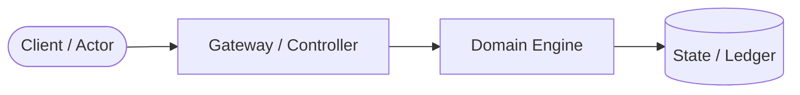

# Technical Design Document (TDD): [Project / Subsystem Name]

- **Associated PRD:** `docs/PRD.md`
- **Status:** Proposed | Locked | Superseded
- **Criticality Tier:** `@criticality:high` | `@criticality:low`
- **Document Authority:** ASEP (Technical Design) compliant with TATANG standards

---

## 1. System Architecture Overview
[High-level system topology, module boundaries, and execution lifelines.]



---

## 2. Structural Architecture & Module Interfaces

### 2.1 Domain Class Diagram (SWEBOK KA 11)
PlantUML structural model capturing domain aggregates, entities, value objects, visibility markers, multiplicities, and relationships (Template: `engineering-specs/templates/class_diagram_template.puml`).

```plantuml
@startuml
!include engineering-specs/templates/class_diagram_template.puml
@enduml
```

### 2.2 Module Interfaces & Design Contracts

#### Module: `[MODULE_NAME]`
- `@design:FR-[MOD]-01`
- `// @criticality:[high|low]`
- **Interface Contract / Signatures:**
  ```rust
  pub trait [TraitName] {
      fn execute_operation(&self, input: InputType) -> Result<OutputType, DomainError>;
  }
  ```

---

## 3. Dynamic Execution & Persistence Lifecycle

### 3.1 Data Schema & Persistence Lifecycle
[Define relational schemas (DBML), key-value storage layouts, or state machine transition definitions.]

- **Relational Schema:** Link to `docs/schema.dbml` or inline table definitions.
- **State Lifecycle:** Link to XState JSON `docs/statecharts/*.json` if finite state validation is required.

### 3.2 Sequence Diagram (Denert Boundary-Control-Entity BCE Architecture)
PlantUML interaction lifeline model depicting message exchange across Boundary, Control, and Entity tiers (Template: `engineering-specs/templates/sequence_bce_template.puml`).

```plantuml
@startuml
!include engineering-specs/templates/sequence_bce_template.puml
@enduml
```

---

## 4. Formal Verification & Benchmarking (for `@criticality:high`)
- **Formal Invariants (Alloy / TLA+):** [Reference to invariants/spec.als or spec.tla]
- **Noise-Floor Microbenchmarks:** `@bench-micro:BM-[MOD]-01` bounded by $64\text{ ns}$ noise floor and $0\text{ B/op}$ heap allocation limit.

---

## 5. Traceability Matrix Summary
| Requirement Tag | Design Interface Tag | Implementation File | Test File |
| :--- | :--- | :--- | :--- |
| `@req:FR-[MOD]-01:MUST` | `@design:FR-[MOD]-01` | `src/[mod]/file.rs` | `tests/[mod]_test.rs` |
