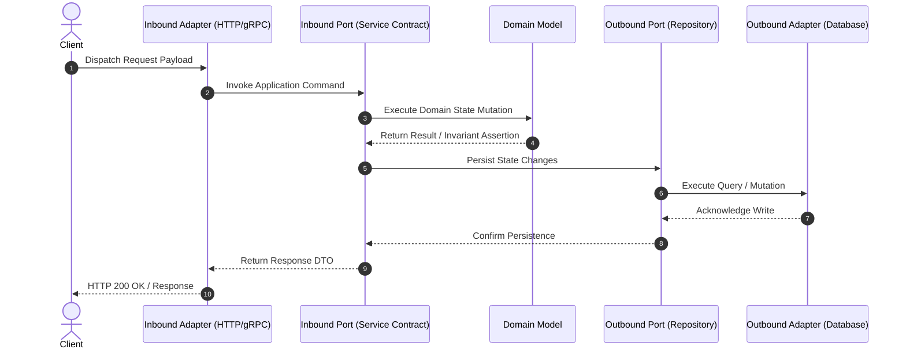

# Repository Architecture & Mental Topology Map

<!-- @gov:ARCH-OVERVIEW -->
## 1. System Overview
<!-- Describe the architectural pattern (Hexagonal, Clean Architecture, Event-Driven, Pipeline) and primary domain problem -->
This repository implements **[Architectural Pattern Name]** designed to **[solve primary engineering problem]**. High-level operational requirements and domain rules are decoupled from external transport adapters and persistence mechanisms.

---

<!-- @gov:ARCH-TOPOLOGY -->
## 2. Physical Directory Topology
<!-- Map all 1st and 2nd level source directories directly to their operational responsibilities. Do not omit any code folders. -->

```text
/
├── cmd/                      # Application entrypoints and CLI runners
│   └── server/               # Main production binary bootstrap
├── src/                      # Core implementation tree
│   ├── domain/               # Pure domain entities, business logic, and invariant rules
│   ├── ports/                # Interface definitions (driving and driven contracts)
│   └── adapters/             # Concrete implementations of ports
│       ├── inbound/          # HTTP, gRPC, and message subscriber controllers
│       └── outbound/         # Database repositories, cache clients, and external HTTP clients
├── tests/                    # Integration and system test suites
│   ├── e2e/                  # End-to-end blackbox execution tests
│   └── integration/          # Out-of-process component verification
└── docs/                     # Formal specifications, ADRs, and architecture runbooks
```

---

<!-- @gov:ARCH-INVARIANTS -->
## 3. Architectural Boundary Invariants
The following dependency constraints are strictly enforced across the codebase:

1. **Inward Dependency Rule:** Outer layers (`adapters`) may depend on inner layers (`ports`, `domain`), but `domain` must NEVER depend on `adapters` or external transport frameworks.
2. **Zero Direct Persistence Access:** Domain logic must interact with persistence exclusively through defined port interfaces.
3. **No Circular Package Imports:** Modules within the same layer must maintain acyclic dependencies.

---

<!-- @gov:ARCH-LIFELINE -->
## 4. Cross-Module Data Flow Lifeline
<!-- Illustrate request traversal from entrypoint to domain core and persistence -->



---

<!-- @gov:ARCH-BINDING -->
## 5. Specification Alignment
<!-- Links exclusively to canonical living specifications. Ephemeral directories (docs/superpowers/, docs/plans/) are prohibited. -->
- **System Requirements:** `docs/PRD.md`
- **Technical Design:** `docs/TDD.md`
- **Architectural Decisions:** `docs/adr/`
- **Formal Invariant Proofs:** `docs/invariants/*.als` (Alloy) or `*.tla` (TLA+)
- **Compiled Vector Diagrams:** `docs/diagrams/rendered/*.svg`
- **Dynamic Trace Manifest (Option C):** `trace_manifest.json`
